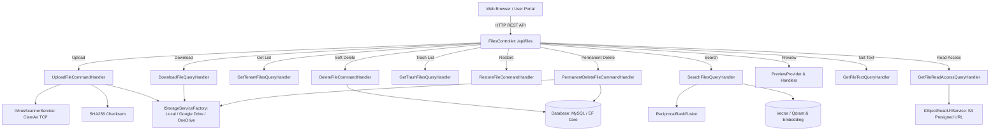

# SDD Phase 0: Master Context Discovery — File Management Subsystem (files)

- **Feature Slug:** `files`
- **Module:** `Core Document Management / Storage Subsystem`
- **Version:** `1.0.0`
- **Scope:** Khảo sát toàn diện bối cảnh, ranh giới kiến trúc, mô hình lưu trữ đa đám mây (Multi-Cloud Storage), hạn mức Quota phân tầng (Tenant → Department → User), và vòng đời tệp tin đầy đủ (Upload, Listing, Download, Soft Delete, Trash Management, Restore, Permanent Delete).
- **Status:** `PENDING HUMAN REVIEW`
- **Spec Depth Baseline:** `DETAILED`
- **Decision Owner:** Tech Lead & Security Lead (@arch-board)

---

## 1. Intent Packet (Mục tiêu Cốt lõi)

### WHAT (Hệ thống cần làm gì ở góc độ người dùng & nghiệp vụ)
Cung cấp một phân hệ quản lý tài liệu doanh nghiệp hoàn chỉnh bao gồm 11 luồng tính năng cốt lõi:
1. **[Tải lên tệp tin (upload)](file:///d:/Ky%209/DoAn_2/.sdd/features/files/upload/SPEC.md):** Tải đơn/đa tệp (tối đa 20 file/100MB), quét mã độc ClamAV thời gian thực (Fail-Closed), tính mã băm SHA-256 bảo đảm toàn vẹn, kiểm tra Quota 3 tầng, bồi hoàn xóa Cloud khi DB lỗi.
2. **[Tải xuống tệp tin (download)](file:///d:/Ky%209/DoAn_2/.sdd/features/files/download/SPEC.md):** Truyền stream nhị phân trực tiếp từ Cloud Provider, phân quyền truy cập 3 tầng chống IDOR/BOLA.
3. **[Xem danh sách & Tổng hợp Quota (get-list)](file:///d:/Ky%209/DoAn_2/.sdd/features/files/get-list/SPEC.md):** Lấy danh sách tệp tin đang hoạt động, lọc theo phòng ban, thư mục, tìm kiếm, tính toán chỉ số Quota (`quota`, `used`, `available`, `usagePercent`).
4. **[Xóa mềm vào Thùng rác (soft-delete)](file:///d:/Ky%209/DoAn_2/.sdd/features/files/soft-delete/SPEC.md):** Đánh dấu `IsDeleted = true`, bảo toàn dữ liệu trên Cloud và bảo toàn hạn mức Quota, thực thi trong giao dịch Serializable.
5. **[Quản lý Thùng rác (trash-list)](file:///d:/Ky%209/DoAn_2/.sdd/features/files/trash-list/SPEC.md):** Xem danh sách tệp tin đã xóa mềm, phân quyền riêng tư theo vai trò (Employee chỉ thấy file của mình), tính tổng dung lượng rác `totalSizeBytes`.
6. **[Khôi phục tệp tin (restore)](file:///d:/Ky%209/DoAn_2/.sdd/features/files/restore/SPEC.md):** Phục hồi trạng thái hoạt động chính, xóa thông tin đánh dấu xóa, ghi nhật ký `RestoreFromTrash`.
7. **[Xóa vĩnh viễn & Hoàn trả Quota (permanent-delete)](file:///d:/Ky%209/DoAn_2/.sdd/features/files/permanent-delete/SPEC.md):** Tiêu hủy dữ liệu vật lý trên Cloud trước, hoàn trả dung lượng Quota 4 tầng và xóa bản ghi CSDL trong giao dịch `Serializable`.
8. **[Tìm kiếm tệp tin chuyên sâu (search)](file:///d:/Ky%209/DoAn_2/.sdd/features/files/search/SPEC.md):** Tìm kiếm lai (Hybrid Search) kết hợp từ khóa SQL và vector ngữ nghĩa qua thuật toán RRF, phân trang bằng con trỏ mã hóa HMAC.
9. **[Xem trước tệp tin (preview)](file:///d:/Ky%209/DoAn_2/.sdd/features/files/preview/SPEC.md):** Kích hoạt và truy vấn trạng thái hiển thị bản xem trước tài liệu đa định dạng (ready 200, pending 202, unavailable 404, unsupported 422).
10. **[Trích xuất văn bản (get-text)](file:///d:/Ky%209/DoAn_2/.sdd/features/files/get-text/SPEC.md):** Đọc nội dung văn bản bóc tách theo từng khối (chunk) có vị trí trang, bảo vệ con trỏ đọc và kiểm tra trạng thái quét virus sạch.
11. **[Cấp quyền đọc trực tiếp (read-access)](file:///d:/Ky%209/DoAn_2/.sdd/features/files/read-access/SPEC.md):** Sinh Presigned Read URL trực tiếp từ S3 Storage cho mục đích tải về, xem inline (whitelist MIME) hoặc phát stream media kèm Audit Log.

### WHY (Tại sao cần tính năng này)
- **Chu trình sống dữ liệu toàn diện:** Đảm bảo dữ liệu tài liệu doanh nghiệp được quản lý bài bản từ khi tải lên đến khi lưu trữ, chia sẻ, đưa vào thùng rác và tiêu hủy vĩnh viễn.
- **Bảo mật và an toàn dữ liệu:** Chống mã độc (ClamAV), chống sửa đổi (SHA-256), chống tấn công leo quyền (Anti-IDOR/BOLA), và bảo toàn dữ liệu trước các sự cố xóa nhầm (Two-Stage Deletion).
- **Quản lý hạn mức tài nguyên (Multi-Tenancy Quota):** Tránh việc cạn kiệt tài nguyên lưu trữ đám mây của doanh nghiệp.

### Definition of Done (DoD của Pha 0)
- [x] Gom nhóm 11 luồng tính năng con thành hệ thống phân mục nhất quán trong `.sdd/features/files/`.
- [x] Mỗi tính năng con đều có tài liệu `CONTEXT.md` và `SPEC.md` độc lập chi tiết.
- [x] Tài liệu Master liên kết toàn diện tới mã nguồn và các quy chuẩn bảo mật Clean Architecture.

---

## 2. Directory Structure of Files Subsystem

```text
.sdd/features/files/
├── CONTEXT.md                    # Master Context Discovery của phân hệ Files
├── SPEC.md                       # Master Specification của phân hệ Files
├── upload/                       # 1. Tải lên tệp tin (Single & Batch Upload)
│   ├── CONTEXT.md
│   ├── SPEC.md
│   └── SECURITY-AUDIT.md         # Báo cáo kiểm toán an ninh bảo mật OWASP Top 10
├── download/                     # 2. Tải xuống tệp tin (Direct Streaming & Anti-IDOR)
│   ├── CONTEXT.md
│   └── SPEC.md
├── get-list/                     # 3. Xem danh sách tệp tin & Tổng hợp hạn mức Quota
│   ├── CONTEXT.md
│   └── SPEC.md
├── soft-delete/                  # 4. Xóa mềm tệp tin vào Thùng rác (Recycle Bin)
│   ├── CONTEXT.md
│   └── SPEC.md
├── trash-list/                   # 5. Xem danh sách tệp tin trong Thùng rác & Dung lượng rác
│   ├── CONTEXT.md
│   └── SPEC.md
├── restore/                      # 6. Khôi phục tệp tin từ Thùng rác
│   ├── CONTEXT.md
│   └── SPEC.md
├── permanent-delete/             # 7. Xóa vĩnh viễn tệp tin & Hoàn trả Quota 4 tầng
│   ├── CONTEXT.md
│   └── SPEC.md
├── search/                       # 8. Tìm kiếm tệp tin nâng cao (Keyword, Semantic & Hybrid RRF)
│   ├── CONTEXT.md
│   └── SPEC.md
├── preview/                      # 9. Xem trước tệp tin (Request & Get Preview)
│   ├── CONTEXT.md
│   └── SPEC.md
├── get-text/                     # 10. Đọc nội dung văn bản bóc tách (OCR / Chunks)
│   ├── CONTEXT.md
│   └── SPEC.md
└── read-access/                  # 11. Cấp quyền đọc trực tiếp qua Presigned URL (S3)
    ├── CONTEXT.md
    └── SPEC.md
```

---

## 3. System Architecture & Component Mapping



### Các Tệp Nguồn Trọng Tâm
- **API Controller:** [FilesController.cs](file:///d:/Ky%209/DoAn_2/Cloud-DMS/src/CleanArchCqrs.API/Controllers/FilesController.cs)
- **Application Commands & Queries:** [Features/Files](file:///d:/Ky%209/DoAn_2/Cloud-DMS/src/CleanArchCqrs.Application/Features/Files)
- **Infrastructure Services:**
  - [ClamAvVirusScannerService.cs](file:///d:/Ky%209/DoAn_2/Cloud-DMS/src/CleanArchCqrs.Infrastructure/Services/ClamAvVirusScannerService.cs)
  - [LocalStorageService.cs](file:///d:/Ky%209/DoAn_2/Cloud-DMS/src/CleanArchCqrs.Infrastructure/Services/Storage/LocalStorageService.cs)
  - [GoogleDriveStorageService.cs](file:///d:/Ky%209/DoAn_2/Cloud-DMS/src/CleanArchCqrs.Infrastructure/Services/Storage/GoogleDriveStorageService.cs)
  - [OneDriveStorageService.cs](file:///d:/Ky%209/DoAn_2/Cloud-DMS/src/CleanArchCqrs.Infrastructure/Services/Storage/OneDriveStorageService.cs)
  - [StorageServiceFactory.cs](file:///d:/Ky%209/DoAn_2/Cloud-DMS/src/CleanArchCqrs.Infrastructure/Services/Storage/StorageServiceFactory.cs)
- **Domain Entities:** [FileEntry.cs](file:///d:/Ky%209/DoAn_2/Cloud-DMS/src/CleanArchCqrs.Domain/Entities/FileEntry.cs), [Folder.cs](file:///d:/Ky%209/DoAn_2/Cloud-DMS/src/CleanArchCqrs.Domain/Entities/Folder.cs)

---

## 4. AI Recommendation & Human Review

### AI Agent Recommendation
- **Status:** `PENDING HUMAN REVIEW`
- **Assessment:** Đã tái cấu trúc và nhóm toàn bộ các luồng tính năng liên quan đến File vào thư mục chung `files/` với cấu trúc chuẩn mực tương đồng `department-admin` và `tenant-admin`.
- **Risk:** Low (Tái tổ chức tài liệu đặc tả, không ảnh hưởng mã nguồn).

### Human Final Review
- **Reviewer:** PENDING HUMAN REVIEW
- **Decision:** PENDING HUMAN REVIEW
- **Timestamp:** PENDING HUMAN REVIEW
