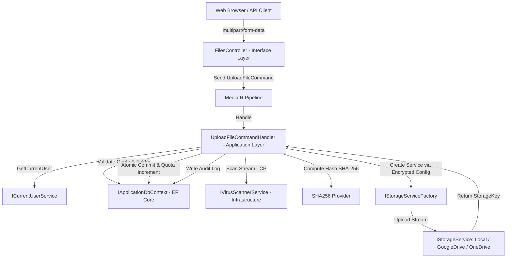

# SDD Phase 0: Context Discovery — File Upload Feature (Tải Lên Tệp Tin)

- **Feature Slug:** `file-upload`
- **Module:** `Core Document Management / Storage Subsystem`
- **Version:** `1.0.0`
- **Scope:** Khảo sát bối cảnh, ranh giới nghiệp vụ và các yêu cầu kỹ thuật cho luồng tải lên tệp tin (đơn tệp và đa tệp) từ giao diện Web đến hệ thống lưu trữ đa đám mây (Multi-Cloud Storage), bao gồm kiểm soát hạn mức Quota 3 tầng, quét mã độc thời gian thực, băm toàn vẹn SHA-256 và cô lập dữ liệu đa người thuê (Multi-Tenancy).
- **Status:** `PENDING HUMAN REVIEW`
- **Spec Depth Baseline:** `DETAILED`
- **Decision Owner:** Product Owner, Lead Architect & Security Lead (@arch-board)

---

## 1. Intent Packet (Mục tiêu Cốt lõi)

### WHAT (Hệ thống cần làm gì ở góc độ người dùng & nghiệp vụ)
1. **Tiếp nhận luồng tải lên an toàn (Secure Upload Ingestion):**
   - Cho phép người dùng (`Employee`, `DepartmentAdmin`, `TenantAdmin`) tải lên một hoặc nhiều tệp tin (tối đa 20 tệp/lần, kích thước tối đa 100 MB/tệp) thông qua API `POST /api/files/upload`.
   - Hỗ trợ tải vào thư mục gốc hoặc thư mục chỉ định (`FolderId`).
2. **Kiểm soát dung lượng 3 tầng (3-Tier Quota Enforcement):**
   - Kiểm tra và đảm bảo tệp tin không vượt quá dung lượng trống của:
     - Hạn mức tổ chức (`Tenant.StorageQuotaBytes`).
     - Hạn mức phòng ban (`Department.StorageQuotaBytes` nếu áp dụng).
     - Hạn mức người dùng cá nhân (`UserStorageQuota.QuotaBytes` nếu được phân bổ).
     - Dung lượng thực tế của Nhà cung cấp lưu trữ đám mây (`StorageProvider.TotalCapacityBytes`).
3. **Bảo mật và toàn vẹn dữ liệu (Malware Protection & Cryptographic Integrity):**
   - Chặn các định dạng tệp tin nguy hiểm và kiểm tra chữ ký định dạng (MIME / Magic bytes).
   - Quét mã độc trực tiếp trên stream thông qua ClamAV Daemon trước khi lưu trữ đám mây, thực thi cơ chế Fail-Closed trên môi trường Non-Development.
   - Tính toán mã băm SHA-256 nhằm đảm bảo tính toàn vẹn và phục vụ chống trùng lặp (Deduplication).
4. **Định tuyến đa đám mây trừu tượng (Multi-Cloud Storage Abstraction):**
   - Định tuyến stream tệp tin đến Storage Provider được cấu hình cho Tenant (Local Storage, Google Drive, OneDrive).
   - Tự động quản lý khóa lưu trữ (`StorageKey`) và phân quyền thư mục.
5. **Ghi vết kiểm toán (Audit Logging):**
   - Ghi nhận đầy đủ lịch sử tải lên thành công, phát hiện mã độc hoặc nỗ lực can thiệp trái phép (`Tampering`) vào nhật ký hệ thống `AuditLog`.

### WHY (Tại sao cần tính năng này & giải quyết vấn đề gì)
- **Bảo vệ hạ tầng trước phần mềm độc hại:** Đảm bảo không người dùng nào có thể vô tình hoặc cố ý tải mã độc, mã thực thi nguy hiểm lên Cloud Storage của doanh nghiệp.
- **Ngăn chặn cạn kiệt tài nguyên (Storage Exhaustion / Denial of Service):** Tránh việc một cá nhân hoặc một phòng ban sử dụng vượt quá hạn mức làm ảnh hưởng đến toàn bộ tổ chức hoặc làm tràn dung lượng Cloud Storage Provider.
- **Bảo vệ quyền riêng tư & phân lập dữ liệu nghiêm ngặt:** Đảm bảo tệp tin tải lên chỉ thuộc về Tenant và Phòng ban của người dùng, ngăn chặn triệt để tấn công BOLA/IDOR (Broken Object Level Authorization).

### Definition of Done (DoD của Pha 0)
- [x] Làm rõ toàn bộ tác nhân (`Actors`), vai trò và quyền hạn tương ứng (`file.upload`).
- [x] Lập từ điển thuật ngữ nghiệp vụ (`Domain Glossary`) chuẩn hóa.
- [x] Xác định rõ ràng các ranh giới kiến trúc (Clean Architecture Layers), luồng dữ liệu (Data Flow) và các điểm giao tiếp bên ngoài (ClamAV, Multi-Cloud APIs, Database).
- [x] Chỉ ra các rủi ro bảo mật tiềm tàng (BOLA, TOCTOU Race Condition, Ghost Files) để đặt tiêu chuẩn cho Pha 1 (SPEC).

---

## 2. Business Context & User Pain Points

| Hiện trạng & Vấn đề (User Pain) | Kỳ vọng giải quyết (Desired Behavior) |
| :--- | :--- |
| **Nguy cơ tệp tin chứa mã độc (Ransomware / Malware):** Tệp tin người dùng tải lên có thể chứa virus, trojan lây lan cho toàn bộ cơ quan. | Tích hợp dịch vụ quét mã độc ClamAV qua giao thức mạng TCP trực tiếp trên Stream. Nếu phát hiện nhiễm độc, ngay lập tức hủy upload, ghi `AuditLog` cảnh báo bảo mật và thông báo rõ mã độc cho người dùng. |
| **Vượt hạn mức Quota do upload đồng thời (Race Condition):** Khi nhiều người dùng tải file dung lượng lớn cùng lúc, dung lượng cộng dồn có thể vượt quá hạn mức Tenant đăng ký với Cloud. | Kiểm tra Quota phân tầng và cập nhật dung lượng an toàn với cơ chế khóa hoặc kiểm soát tương tranh (Optimistic / Pessimistic Concurrency), đảm bảo không xảy ra hiện tượng vượt ngưỡng (Quota Leak / Bypass). |
| **Lỗi tệp rác trên Cloud (Ghost / Orphan Files):** Tệp tin đã upload thành công lên Google Drive/OneDrive nhưng lệnh ghi CSDL thất bại, dẫn đến tệp tin mồ côi chiếm dung lượng vĩnh viễn trên Cloud. | Triển khai mô hình bồi hoàn (Compensating Transaction): Nếu ghi metadata vào CSDL thất bại, hệ thống tự động gọi hàm xóa tệp tin vừa tải lên Cloud Storage Provider tương ứng. |
| **Tấn công leo quyền gán thư mục chéo (Cross-Tenant Folder IDOR):** Kẻ tấn công truyền `FolderId` của Tenant khác hoặc Phòng ban khác để đính kèm file trái phép. | Xác thực chặt chẽ quyền sở hữu của `FolderId`: Kiểm tra thư mục phải tồn tại, thuộc cùng `TenantId` và `DepartmentId` tương ứng trước khi tiến hành lưu trữ. |
| **Định dạng file giả mạo (Extension Spoofing):** Kẻ tấn công đổi đuôi file `.exe` thành `.pdf` hoặc lợi dụng đuôi kép `.php.jpg` để vượt qua bộ lọc đơn giản. | Triển khai xác thực đa lớp: Danh sách trắng phần mở rộng (Whitelist), kiểm tra MIME type thực tế và chữ ký nhị phân (Magic Bytes), từ chối danh sách đen mở rộng đơn thuần. |

---

## 3. Domain Glossary (Thuật ngữ Nghiệp vụ)

- **FileEntry:** Thực thể trung tâm đại diện cho siêu dữ liệu của một tệp tin (Metadata) gồm: `Id`, `TenantId`, `DepartmentId`, `OwnerId`, `FolderId`, `Name`, `StorageKey`, `ContentType`, `SizeBytes`, `Hash`, `ScanStatus`, `Lifecycle`.
- **StorageKey:** Khóa định danh duy nhất của tệp tin trên nhà cung cấp lưu trữ (đường dẫn tương đối trên đĩa cục bộ, hoặc File ID trên Google Drive / OneDrive).
- **StorageProvider:** Thực thể quản lý cấu hình kết nối tới kho lưu trữ đám mây (`Type`: `Local`, `GoogleDrive`, `OneDrive`; `ConfigEncrypted`: chuỗi cấu hình JSON được mã hóa AES-256-GCM; `TotalCapacityBytes`, `UsedCapacityBytes`).
- **UserStorageQuota:** Bản ghi hạn mức lưu trữ cá nhân do Trưởng phòng phân bổ cho từng nhân viên (`QuotaBytes`, `UsedBytes`).
- **ClamAV TCP Stream:** Giao thức truyền dữ liệu nhị phân dạng chunk (`zINSTREAM`) tới ClamAV daemon trên cổng 3310 để quét mã độc mà không cần lưu file tạm ra ổ đĩa.
- **SHA-256 Checksum:** Chuỗi băm 64 ký tự thập lục phân (hex) biểu diễn tính toàn vẹn tuyệt đối của nội dung tệp tin.
- **MultipleFileUploadResultDto:** Đối tượng phản hồi chứa danh sách tệp tin tải lên thành công (`Uploaded`) và các tệp tin thất bại kèm thông báo lỗi chi tiết (`Failed`).

---

## 4. System Boundaries & Clean Architecture Mapping

### Phân tầng trách nhiệm:
1. **Interface Layer (`CleanArchCqrs.API.Controllers.FilesController`):**
   - Tiếp nhận HTTP request `multipart/form-data`.
   - Giới hạn kích thước payload `[RequestSizeLimit(100MB)]`.
   - Thực thi giới hạn tốc độ gọi `[EnableRateLimiting("upload")]`.
   - Kiểm tra xác thực và phân quyền chính sách `[Authorize(Policy = "file.upload")]`.
2. **Application Layer (`CleanArchCqrs.Application.Features.Files`):**
   - Điều phối toàn bộ luồng nghiệp vụ: Xác thực danh tính người dùng (`ICurrentUserService`), kiểm tra trạng thái hoạt động của Tenant, xác thực tính hợp lệ của `FolderId`.
   - Kiểm tra Quota 3 tầng và cập nhật hạn mức.
   - Gọi cổng quét mã độc (`IVirusScannerService`) và băm dữ liệu.
   - Khởi tạo Storage Service phù hợp qua `IStorageServiceFactory`.
   - Ghi nhận `AuditLog` cho mọi trường hợp tải lên, phát hiện mã độc hoặc cố gắng thay đổi danh tính trái phép.
3. **Infrastructure Layer (`CleanArchCqrs.Infrastructure`):**
   - Triển khai `ClamAvVirusScannerService` kết nối TCP Socket tới ClamAV daemon.
   - Triển khai `LocalStorageService`, `GoogleDriveStorageService`, `OneDriveStorageService`.
   - Giải mã thông tin cấu hình qua `IAesEncryptionService`.
4. **Domain Layer (`CleanArchCqrs.Domain`):**
   - Chứa các Invariants, Entities (`FileEntry`, `Tenant`, `Department`, `StorageProvider`, `UserStorageQuota`, `Folder`, `AuditLog`) và Enums (`FileLifecycle`, `StorageProviderType`).

---

## 5. Target Components & Source Files

- **API Controller:** [`FilesController.cs`](file:///d:/Ky%209/DoAn_2/Cloud-DMS/src/CleanArchCqrs.API/Controllers/FilesController.cs) (Line 21 - 107)
- **Command & Request:** [`UploadFileCommand.cs`](file:///d:/Ky%209/DoAn_2/Cloud-DMS/src/CleanArchCqrs.Application/Features/Files/Commands/UploadFile/UploadFileCommand.cs)
- **Handler:** [`UploadFileCommandHandler.cs`](file:///d:/Ky%209/DoAn_2/Cloud-DMS/src/CleanArchCqrs.Application/Features/Files/Commands/UploadFile/UploadFileCommandHandler.cs)
- **DTOs:** [`MultipleFileUploadResultDto.cs`](file:///d:/Ky%209/DoAn_2/Cloud-DMS/src/CleanArchCqrs.Application/Features/Files/DTOs/MultipleFileUploadResultDto.cs), [`FileEntryDto.cs`](file:///d:/Ky%209/DoAn_2/Cloud-DMS/src/CleanArchCqrs.Application/Features/Files/DTOs/FileEntryDto.cs)
- **Storage Services:** [`LocalStorageService.cs`](file:///d:/Ky%209/DoAn_2/Cloud-DMS/src/CleanArchCqrs.Infrastructure/Services/Storage/LocalStorageService.cs), [`GoogleDriveStorageService.cs`](file:///d:/Ky%209/DoAn_2/Cloud-DMS/src/CleanArchCqrs.Infrastructure/Services/Storage/GoogleDriveStorageService.cs), [`OneDriveStorageService.cs`](file:///d:/Ky%209/DoAn_2/Cloud-DMS/src/CleanArchCqrs.Infrastructure/Services/Storage/OneDriveStorageService.cs)
- **Antivirus Service:** [`ClamAvVirusScannerService.cs`](file:///d:/Ky%209/DoAn_2/Cloud-DMS/src/CleanArchCqrs.Infrastructure/Services/ClamAvVirusScannerService.cs)
- **Entities & Configuration:** [`FileEntry.cs`](file:///d:/Ky%209/DoAn_2/Cloud-DMS/src/CleanArchCqrs.Domain/Entities/FileEntry.cs), [`Folder.cs`](file:///d:/Ky%209/DoAn_2/Cloud-DMS/src/CleanArchCqrs.Domain/Entities/Folder.cs), [`Tenant.cs`](file:///d:/Ky%209/DoAn_2/Cloud-DMS/src/CleanArchCqrs.Domain/Entities/Tenant.cs)

---

## 6. Open Questions & Assumptions

1. **Vấn đề FolderId trên Google Drive / OneDrive:** Hiện tại `Folder` trong CSDL chỉ có `Id` kiểu GUID. Khi người dùng truyền `FolderId`, hệ thống đang truyền `FolderId.Value.ToString()` làm ID thư mục cha lên Google Drive. Nếu thư mục cha trên Cloud cần một ID định danh đặc thù từ Cloud Provider (ví dụ Google Drive Folder ID), cần bổ sung cột `StorageFolderId` vào bảng `Folders`.
2. **Quy tắc Whitelist vs Blacklist:** Hiện tại Controller đang dùng danh sách đen `BlockedExtensions`. Cần nâng cấp lên danh sách trắng (Whitelist) cấu hình theo Tenant hoặc kiểm tra Magic Bytes để chống giả mạo định dạng.
3. **Cơ chế bồi hoàn Rollback:** Cần bổ sung khối `try/catch` xung quanh `SaveChangesAsync` để tự động dọn dẹp file trên Cloud nếu lưu metadata thất bại.

---

## 7. AI Recommendation & Human Review

### AI Agent Recommendation
- **Status:** `PENDING HUMAN REVIEW`
- **Assessment:** Tài liệu CONTEXT phân tích đầy đủ hiện trạng, ranh giới và các lỗ hổng tiềm ẩn trong luồng tải lên tệp tin. Đề xuất Human Reviewer phê duyệt để làm cơ sở khóa SPEC.md.
- **Risk:** High (Liên quan trực tiếp đến bảo mật dữ liệu doanh nghiệp, mã độc và tính toàn vẹn Quota).

### Human Final Review
- **Reviewer:** PENDING HUMAN REVIEW
- **Decision:** PENDING HUMAN REVIEW
- **Timestamp:** PENDING HUMAN REVIEW
