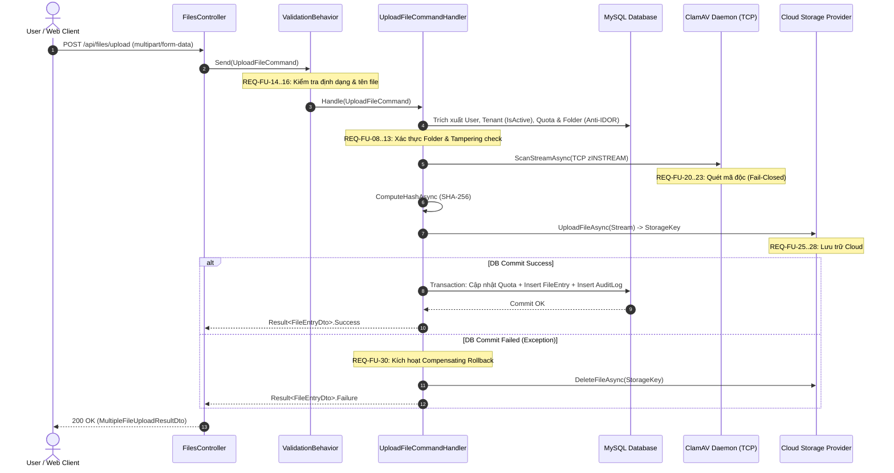

# SDD Phase 2: Architecture Planning — File Upload Subsystem (upload)

- **Feature Slug:** `files/upload`
- **Module:** `Core Document Management / Storage Subsystem`
- **Version:** `1.0.0`
- **Status:** `APPROVED`
- **Spec Reference:** `SPEC.md` (v1.0.0 — `DETAILED`)
- **Spec Depth Baseline:** `DETAILED`
- **Risk Posture:** `HIGH`
- **Decision Owner:** Tech Lead & Security Lead (@arch-board)

---

## 1. Architectural Approach

Hệ thống triển khai theo mô hình **Clean Architecture & CQRS** kết hợp **MediatR Pipeline** và cơ chế bảo vệ giao dịch phân tán (Saga / Compensating Transaction) giữa Cloud Storage và Relational Database:

1. **Validation Pipeline Behavior:** Sử dụng `FluentValidation` thông qua `UploadFileCommandValidator` để chặn các dữ liệu đầu vào không hợp lệ (kích thước file, extension cấm, tên file chứa mã độc/path traversal) trước khi command tiến vào Handler.
2. **Fail-Closed Multi-Tenancy & Folder Authorization (Anti-BOLA):** Bổ sung bước xác thực quyền sở hữu thư mục đích (`FolderId`) và kiểm tra cờ kích hoạt của Tổ chức (`Tenant.IsActive`) trước khi thực hiện bất kỳ thao tác I/O nào.
3. **Compensating Rollback:** Bọc khối ghi nhận cơ sở dữ liệu (`SaveChangesAsync`) trong cơ chế dọn dẹp bồi hoàn: Nếu lưu CSDL thất bại, tự động kích hoạt `storageService.DeleteFileAsync(storageKey)` để xóa tệp tin vừa tải lên Cloud Provider, loại bỏ triệt để lỗi tệp tin mồ côi (Ghost Files).
4. **Concurrency-Controlled Quota Mutation:** Bọc quá trình kiểm tra và cập nhật dung lượng `StorageUsedBytes` trong giao dịch CSDL với mức độ cô lập an toàn, tránh điều kiện tương tranh (TOCTOU race conditions).
5. **Security Tampering Audit Trail:** Bổ sung việc ghi `AuditLog` tự động cho mọi hành vi giả mạo `UserIdOverride` hoặc `TenantIdOverride` nhằm giám sát các cuộc tấn công leo quyền.

---

## 2. REQ-to-Component Mapping

| Requirement | Mô tả nghiệp vụ | Thành phần phụ trách | Lớp kiến trúc (Layer) | Đường dẫn tệp tin |
| :--- | :--- | :--- | :--- | :--- |
| **REQ-FU-01 → REQ-FU-07** | Tiếp nhận HTTP, Rate Limiting, Size Limit 100MB, Batch <= 20 | `FilesController` | Interface Layer | `src/CleanArchCqrs.API/Controllers/FilesController.cs` |
| **REQ-FU-08 → REQ-FU-10** | Trích xuất danh tính, kiểm tra `user.IsActive`, kiểm tra `tenant.IsActive` | `UploadFileCommandHandler` | Application Layer | `src/CleanArchCqrs.Application/Features/Files/Commands/UploadFile/UploadFileCommandHandler.cs` |
| **REQ-FU-11** | Ghi nhận cảnh báo an ninh khi giả mạo Override ID | `UploadFileCommandHandler` & `AuditLog` | Application / Domain | `src/CleanArchCqrs.Application/Features/Files/Commands/UploadFile/UploadFileCommandHandler.cs` |
| **REQ-FU-12 → REQ-FU-13** | Xác thực quyền sở hữu `FolderId` (Anti-BOLA) | `UploadFileCommandHandler` & `Folder` Entity | Application / Domain | `src/CleanArchCqrs.Application/Features/Files/Commands/UploadFile/UploadFileCommandHandler.cs` |
| **REQ-FU-14 → REQ-FU-16** | Whitelist định dạng, chặn extension cấm, sanitize tên file | `UploadFileCommandValidator` | Application Layer | `src/CleanArchCqrs.Application/Features/Files/Commands/UploadFile/UploadFileCommandValidator.cs` |
| **REQ-FU-17 → REQ-FU-19** | Kiểm tra Quota 3 tầng và cập nhật kiểm soát tương tranh | `UploadFileCommandHandler` | Application Layer | `src/CleanArchCqrs.Application/Features/Files/Commands/UploadFile/UploadFileCommandHandler.cs` |
| **REQ-FU-20 → REQ-FU-23** | Quét mã độc ClamAV thời gian thực (Fail-Closed) | `ClamAvVirusScannerService` | Infrastructure Layer | `src/CleanArchCqrs.Infrastructure/Services/ClamAvVirusScannerService.cs` |
| **REQ-FU-24** | Tính mã băm SHA-256 toàn vẹn | `SHA256` Cryptography | Application / Infra | `src/CleanArchCqrs.Application/Features/Files/Commands/UploadFile/UploadFileCommandHandler.cs` |
| **REQ-FU-25 → REQ-FU-28** | Định tuyến Multi-Cloud qua AES giải mã cấu hình | `StorageServiceFactory` & `IStorageService` | Infrastructure Layer | `src/CleanArchCqrs.Infrastructure/Services/Storage/` |
| **REQ-FU-29 → REQ-FU-30** | Lưu CSDL nguyên khối & Bồi hoàn xóa file Cloud khi DB lỗi | `UploadFileCommandHandler` | Application Layer | `src/CleanArchCqrs.Application/Features/Files/Commands/UploadFile/UploadFileCommandHandler.cs` |
| **REQ-FU-31 → REQ-FU-32** | Phân lập tệp tin trong Batch Upload, trả về DTOs | `FilesController` | Interface Layer | `src/CleanArchCqrs.API/Controllers/FilesController.cs` |

---

## 3. Components Architecture Breakdown

### 3.1 Application Layer
- **`UploadFileCommandValidator.cs` (New):**
  - Kế thừa `AbstractValidator<UploadFileCommand>`.
  - Validate: `FileSize > 0 && FileSize <= 100MB`.
  - Validate: `FileName` không được rỗng, không chứa ký tự điều khiển hoặc path traversal (`../`, `..\`).
  - Validate: `FileName` không có đuôi trong danh sách đen mở rộng hoặc bắt buộc thuộc Whitelist cấu hình.
- **`UploadFileCommandHandler.cs` (Refactor):**
  - Bổ sung xác thực `tenant.IsActive` và `provider.IsActive`.
  - Bổ sung kiểm tra `request.FolderId`: Truy vấn bảng `Folders` kiểm tra `TenantId` và phân quyền phòng ban.
  - Bổ sung ghi `AuditLog` (`Action = "SecurityTamperingAttempt"`) khi phát hiện can thiệp `UserIdOverride` / `TenantIdOverride`.
  - Bổ sung cơ chế bồi hoàn Rollback: Bọc `_context.SaveChangesAsync` trong `try / catch`, gọi `storageService.DeleteFileAsync(storageKey)` nếu xảy ra lỗi.
  - Bọc cập nhật Quota trong Database Transaction có kiểm soát tương tranh.

### 3.2 Interface Layer
- **`FilesController.cs` (Refactor):**
  - Loại bỏ danh sách đen `BlockedExtensions` hardcode tại Controller; chuyển trách nhiệm xác thực định dạng vào `UploadFileCommandValidator`.
  - Chuẩn hóa việc bắt lỗi từ MediatR Pipeline để trả về DTO `MultipleFileUploadResultDto` chuẩn xác.

---

## 4. Data Flow

---

## 5. State-Change Classification

| Luồng thao tác / Thành phần | Phân loại thay đổi (Category) | Checkpoint yêu cầu |
| :--- | :--- | :--- |
| **Validation Input (Validator)** | `none` | Không có mutation dữ liệu |
| **Tampering Alert Logging** | `persistence schema/business-data mutation` | Ghi bản ghi cảnh báo vào bảng `AuditLogs` |
| **Upload file vật lý lên Cloud** | `external/irreversible side effect` | Yêu cầu Compensating Rollback nếu CSDL lỗi |
| **Cộng dung lượng Quota & Tạo FileEntry** | `persistence schema/business-data mutation` | Transaction kiểm soát tương tranh |
| **Compensating Delete trên Cloud** | `external/irreversible side effect` | Dọn dẹp file rác khi DB commit thất bại |

---

## 6. Consistency Map

| Requirement | Thành phần Plan | Task kỳ vọng | Exact Verification Command | Post-Code Review Trigger |
| :--- | :--- | :--- | :--- | :--- |
| **REQ-FU-14..16** | `UploadFileCommandValidator` | `T001` | `dotnet build "Cloud-DMS/src/CleanArchCqrs.Application/CleanArchCqrs.Application.csproj"` | Unit Test validation rules |
| **REQ-FU-08..13** | Inactive Tenant & Folder Authorization | `T002` | `dotnet build "Cloud-DMS/src/CleanArchCqrs.Application/CleanArchCqrs.Application.csproj"` | Security review Anti-BOLA |
| **REQ-FU-11** | Security Tampering Audit Logging | `T003` | `dotnet build "Cloud-DMS/src/CleanArchCqrs.Application/CleanArchCqrs.Application.csproj"` | Audit log verification |
| **REQ-FU-17..19** | Quota Concurrency Transaction | `T004` | `dotnet build "Cloud-DMS/src/CleanArchCqrs.Application/CleanArchCqrs.Application.csproj"` | Concurrency test |
| **REQ-FU-29..30** | Cloud Compensating Rollback | `T005` | `dotnet build "Cloud-DMS/src/CleanArchCqrs.Application/CleanArchCqrs.Application.csproj"` | Rollback test |
| **REQ-FU-01..07, 31..32** | FilesController Refactoring | `T006` | `dotnet build "Cloud-DMS/src/CleanArchCqrs.API/CleanArchCqrs.API.csproj"` | Integration endpoint test |

---

## 7. Risks & Mitigations

1. **Rủi ro rò rỉ file rác trên Cloud khi DB lưu thất bại (Ghost Files):**
   - *Mitigation:* Triển khai khối `try / catch` bọc `SaveChangesAsync`. Khi phát sinh bất kỳ ngoại lệ nào, hệ thống gọi `await storageService.DeleteFileAsync(storageKey)` để xóa file vừa tạo trên Cloud trước khi ném lỗi ra ngoài.
2. **Rủi ro điều kiện tương tranh Quota (TOCTOU Race Condition):**
   - *Mitigation:* Cập nhật hạn mức trong CSDL Transaction sử dụng `CreateExecutionStrategy` hoặc kiểm tra dung lượng ngay trước khi commit.
3. **Rủi ro tấn công BOLA qua `FolderId` của Tenant khác:**
   - *Mitigation:* Bắt buộc kiểm tra `folder.TenantId == tenant.Id` và phân quyền phòng ban trước khi xử lý luồng upload.
4. **Rủi ro nghẽn I/O khi file lớn hoặc mạng chậm:**
   - *Mitigation:* Giới hạn kích thước file tối đa 100MB, truyền stream theo chunk buffer 8192 bytes, timeout kết nối ClamAV tối đa 3 giây.

---

## 8. Questions for Human Reviewer

### Q1: Hành vi khi thư mục cha `FolderId` bị xóa mềm (`Folder.IsDeleted == true`)
- **Điều chưa rõ:** Spec yêu cầu kiểm tra folder thuộc Tenant và Department, nhưng chưa nêu rõ nếu thư mục đang nằm trong thùng rác thì có cho phép upload vào đó hay không.
- **Assumption hiện tại:** Nếu thư mục cha đang ở trạng thái xóa mềm (`IsDeleted == true`), hệ thống coi như không tồn tại và từ chối tải lên: `"Thư mục đích không tồn tại hoặc đã bị xóa."`
- **Ảnh hưởng nếu sai:** Cần bổ sung logic cho phép khôi phục folder hoặc cho phép đính kèm file vào folder trong thùng rác.
- **Câu hỏi cụ thể:** Chặn upload vào thư mục đang bị xóa mềm có đúng với nghiệp vụ mong muốn không? (Đề xuất: YES).
- **Human Decision:** `APPROVED` — Đồng ý: Thư mục đã bị xóa mềm (`IsDeleted == true`) thì không cho phép tải tệp tin vào.

### Q2: Cơ chế Whitelist định dạng tệp tin
- **Điều chưa rõ:** Spec nêu cấu hình danh sách loại tệp được phép cho Tenant hoặc danh sách đen.
- **Assumption hiện tại:** Tầng Application sẽ triển khai bộ lọc chặn danh sách nguy hiểm (`.exe`, `.bat`, `.cmd`, `.sh`, `.php`, `.vbs`, `.js`, `.ps1`, `.msi`, `.dll`, `.jar`, `.com`, `.pif`, `.scr`, `.hta`, `.jsp`, `.aspx`, `.cgi`, `.config`) kết hợp kiểm tra độ dài tên file và loại bỏ ký tự điều khiển.
- **Ảnh hưởng nếu sai:** Cần tạo bảng cấu hình Whitelist động trong CSDL cho từng Tenant.
- **Câu hỏi cụ thể:** Sử dụng danh sách chặn nguy hiểm toàn diện trong Validator có phù hợp ở phiên bản v1.0.0 này không? (Đề xuất: YES).
- **Human Decision:** `APPROVED` — Đồng ý: Sử dụng danh sách chặn nguy hiểm toàn diện và làm sạch tên file trong `UploadFileCommandValidator`.

---

## 9. Definition of Done (DoD)

- [x] Kiến trúc phân tầng Clean Architecture tuân thủ đầy đủ.
- [x] Toàn bộ các yêu cầu `REQ-FU-01` đến `REQ-FU-32` đã được ánh xạ vào thành phần cụ thể.
- [x] Có chiến lược bồi hoàn Rollback xóa file Cloud khi CSDL gặp sự cố.
- [x] Có chiến lược phòng chống tấn công BOLA trên `FolderId`.
- [x] Nêu rõ ít nhất 3 rủi ro kỹ thuật và phương án khắc phục.
- [x] Phần "Questions for Human reviewer" đã nêu rõ các giả định kỹ thuật và được Human duyệt.

---

## 10. AI Recommendation & Human Final Review

### AI Agent Recommendation
- **Status:** `APPROVED BY HUMAN REVIEWER`
- **Assessment:** Kế hoạch kỹ thuật (PLAN.md) giải quyết triệt để 3 lỗ hổng CRITICAL và các lỗ hổng HIGH đã phát hiện trong kiểm toán bảo mật, tuân thủ chặt chẽ Clean Architecture. Đã có đầy đủ phê duyệt từ Human Reviewer để phân rã và triển khai mã nguồn.
- **Risk:** High (Core upload ingestion pipeline).

### Human Final Review
- **Reviewer:** Authorized Human Reviewer / Tech Lead
- **Decision:** APPROVED
- **Timestamp:** 2026-10-14T14:26:00+07:00
- **Follow-up:** Chuyển sang thực thi các công việc trong TASKS.md (v1.0.0 — READY)
