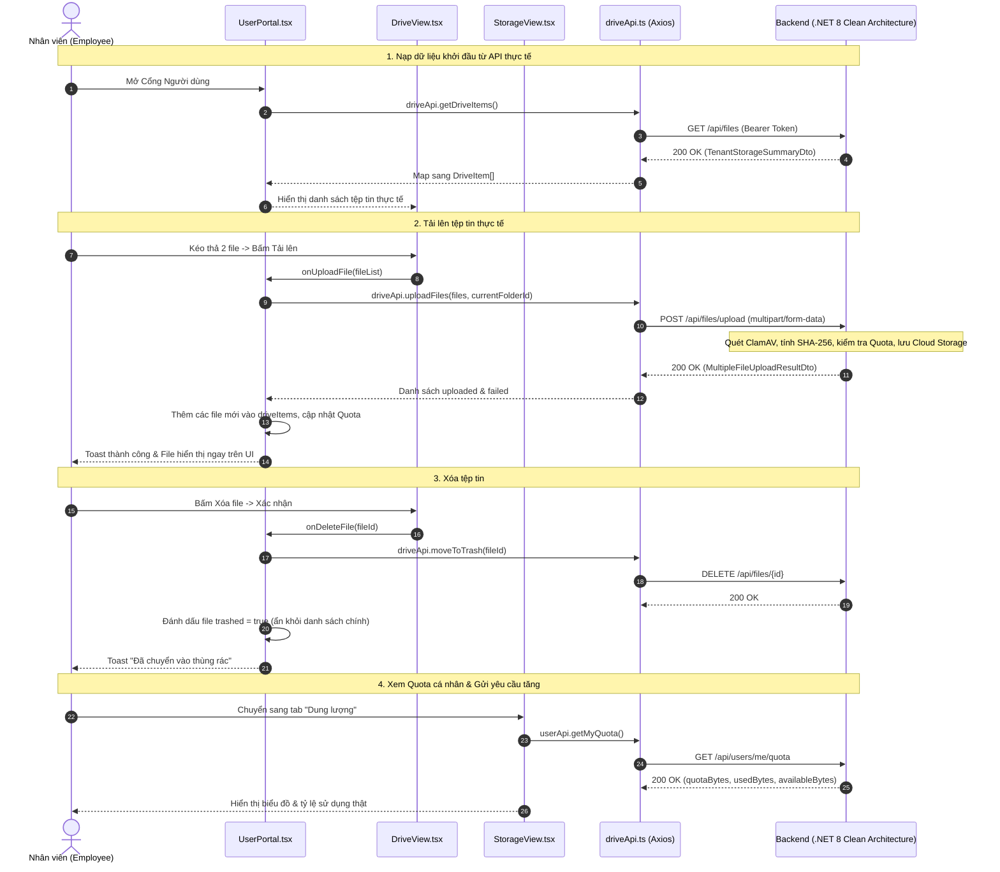

# Master Implementation Plan (PLAN.md) — User Portal API Integration

- **Feature Scope:** Tích hợp API Cổng Người dùng: Quản lý Quota cá nhân (`get-user-storage-quota`) & Kết nối luồng Tải lên (`upload-file`) và Xóa tệp tin (`soft-delete`, `permanent-delete`).
- **Module:** `User Portal` (`user`)
- **Version:** `1.0.0`
- **Status:** `PENDING HUMAN REVIEW`
- **Plan Depth:** `DETAILED`
- **Decision Owner:** Tech Lead & Security Lead (`@architecture-team`)

---

## 1. Architectural Approach

### 1.1 Mục tiêu Kỹ thuật
Xóa bỏ hoàn toàn chế độ dữ liệu giả lập (Mock Data) trong `Cloud-DMS-FE/src/features/user`, thay thế bằng luồng gọi API thực tế hai chiều giữa giao diện React và hệ thống Backend Clean Architecture CQRS:
1. **Luồng Quota cá nhân (`get-user-storage-quota`):**
   - Viết API Backend mới: `GET /api/users/me/quota` (truy vấn `UserStorageQuotas` theo `currentUserId`) và `POST /api/users/request-quota` (gửi đề xuất xin tăng Quota).
   - Kết nối dữ liệu thật vào [StorageView.tsx](file:///d:/Ky%209/DoAn_2/Cloud-DMS-FE/src/features/user/views/StorageView.tsx) và [RequestQuotaModal.tsx](file:///d:/Ky%209/DoAn_2/Cloud-DMS-FE/src/features/user/components/AdjustQuotaModal.tsx).
2. **Luồng Tải lên tệp tin (`upload-file`):**
   - Chuẩn hóa hàm `uploadFiles` trong [driveApi.ts](file:///d:/Ky%209/DoAn_2/Cloud-DMS-FE/src/features/user/api/driveApi.ts) để gửi `multipart/form-data` tới `POST /api/files/upload`.
   - Chuyển đổi phản hồi `MultipleFileUploadResultDto` sang cấu trúc `DriveItem` của Frontend.
   - Thay thế `handleUploadFiles` trong [UserPortal.tsx](file:///d:/Ky%209/DoAn_2/Cloud-DMS-FE/src/features/user/UserPortal.tsx) bằng lệnh gọi API thực tế, hiển thị loading và toast kết quả.
3. **Luồng Xóa tệp tin (Soft Delete & Permanent Delete):**
   - Thay thế `handleDeleteItem` trong `UserPortal.tsx` bằng lời gọi API `DELETE /api/files/{id}` (Soft Delete).
   - Bổ sung hàm gọi API `DELETE /api/files/{id}/permanent` khi xóa vĩnh viễn trong Thùng rác.
   - Bổ sung hàm gọi API `POST /api/files/{id}/restore` khi khôi phục tệp tin.
4. **Luồng Nạp danh sách tệp tin thực tế:**
   - Thay thế `useState(INITIAL_DRIVE_ITEMS)` bằng `useEffect` gọi `GET /api/files` khi người dùng vào trang.

---

## 2. REQ-to-Component Mapping

| Nhóm Nghiệp vụ | Mã Requirement | Thành phần & Trách nhiệm | File Path |
| :--- | :--- | :--- | :--- |
| **Quota Cá nhân** | `EARS-QT-01` | Query & Handler lấy Quota của chính user gọi | `CleanArchCqrs.Application/Features/Users/Queries/GetMyStorageQuota/` |
| **Quota Cá nhân** | `EARS-QT-03` | Command & Handler gửi phiếu xin tăng Quota | `CleanArchCqrs.Application/Features/Users/Commands/RequestQuotaIncrease/` |
| **Quota Cá nhân** | `EARS-QT-01..03` | Controller tiếp nhận request quota | `CleanArchCqrs.API/Controllers/UserQuotaController.cs` |
| **Quota Cá nhân** | `EARS-QT-01..03` | View hiển thị chỉ số & gửi yêu cầu Quota | `Cloud-DMS-FE/src/features/user/views/StorageView.tsx` |
| **Tải lên File** | `REQ-UP-01..10` | Chuẩn hóa API Client gửi `FormData` và map DTO | `Cloud-DMS-FE/src/features/user/api/driveApi.ts` |
| **Tải lên File** | `REQ-UP-01..10` | Handler tải file, cập nhật state UI và Quota | `Cloud-DMS-FE/src/features/user/UserPortal.tsx` |
| **Xóa mềm File** | `REQ-SD-01..11` | Handler gọi `DELETE /api/files/{id}`, ẩn file | `Cloud-DMS-FE/src/features/user/UserPortal.tsx` |
| **Xóa vĩnh viễn**| `REQ-PD-01..05` | Handler gọi `DELETE /api/files/{id}/permanent` | `Cloud-DMS-FE/src/features/user/UserPortal.tsx` |
| **Khôi phục File**| `REQ-RS-01..05` | Handler gọi `POST /api/files/{id}/restore` | `Cloud-DMS-FE/src/features/user/UserPortal.tsx` |
| **Danh sách File**| `REQ-GL-01..06` | Nạp dữ liệu ban đầu từ `GET /api/files` | `Cloud-DMS-FE/src/features/user/UserPortal.tsx` |

---

## 3. Data Flow



---

## 4. State-Change Classification

| Thành phần / Luồng | Phân loại | Checkpoint & Ràng buộc |
| :--- | :--- | :--- |
| `GET /api/files`, `GET /api/users/me/quota` | `none` (Read-only) | Đọc CSDL không làm thay đổi trạng thái. |
| `POST /api/files/upload` | `persistence schema mutation` + `external side effect` | Ghi file vật lý lên Cloud Storage và tạo bản ghi `FileEntry` CSDL. |
| `DELETE /api/files/{id}` | `persistence schema mutation` | Cập nhật `IsDeleted = true` trong CSDL qua Serializable transaction. |
| `DELETE /api/files/{id}/permanent` | `persistence schema mutation` + `external side effect` | Xóa file trên Cloud và xóa bản ghi CSDL, trừ Quota `Serializable`. |
| `POST /api/users/request-quota` | `business-data mutation` | Lưu AuditLog/Notification cho Trưởng phòng. |

---

## 5. Shared-Contract & DTOs

### 5.1 Backend Contracts
1. **Query:** `GetMyStorageQuotaQuery : IRequest<Result<PersonalStorageQuotaDto>>`
2. **DTO:**
   ```csharp
   public record PersonalStorageQuotaDto(
       Guid UserId,
       string FullName,
       long QuotaBytes,
       long UsedBytes,
       long AvailableBytes,
       double UsagePercent,
       string? DepartmentName
   );
   ```
3. **Command:** `RequestQuotaIncreaseCommand(int RequestedGB, string Reason) : IRequest<Result<bool>>`

### 5.2 Frontend DTO & Mapping (driveApi.ts)
```typescript
// Mapping từ FileEntryDto của Backend sang DriveItem của Frontend
export const mapFileEntryToDriveItem = (dto: any): DriveItem => ({
  id: dto.id,
  name: dto.name,
  type: 'file',
  size: dto.sizeBytes,
  sizeFormatted: formatBytes(dto.sizeBytes),
  updatedAt: new Date(dto.createdAt).toLocaleDateString('vi-VN'),
  createdAt: new Date(dto.createdAt).toLocaleDateString('vi-VN'),
  owner: {
    name: dto.ownerName || 'Tôi',
    email: dto.ownerEmail || '',
  },
  parentId: dto.folderId || null,
  starred: dto.isStarred || false,
  trashed: dto.isDeleted || false,
  sharedWith: [],
  tags: [dto.contentType?.split('/')[1]?.toUpperCase() || 'FILE'],
  department: dto.departmentName || '',
});
```

---

## 6. Consistency Map

| Requirement | Kế hoạch thực hiện | Task cụ thể | Lệnh kiểm tra xác thực |
| :--- | :--- | :--- | :--- |
| `EARS-QT-01` | Tạo `GetMyStorageQuotaQuery` | Viết Query & Handler backend | `dotnet test --filter "FullyQualifiedName~GetMyStorageQuota"` |
| `EARS-QT-03` | Tạo `RequestQuotaIncreaseCommand` | Viết Command, Validator & Handler | `dotnet test --filter "FullyQualifiedName~RequestQuota"` |
| `REQ-UP-01` | Tích hợp upload thực tế | Nâng cấp `driveApi.uploadFiles` & `handleUploadFiles` | Kiểm tra tải lên file thật qua UI |
| `REQ-SD-01` | Tích hợp xóa mềm thực tế | Nâng cấp `driveApi.moveToTrash` & `handleDeleteItem` | Kiểm tra đưa file vào thùng rác qua UI |
| `REQ-PD-01` | Tích hợp xóa vĩnh viễn | Gọi `DELETE /api/files/{id}/permanent` | Kiểm tra giải phóng Quota qua UI |

---

## 7. Dependencies & Kế hoạch Triển khai theo Thứ tự (Phased Rollout)

### Bước 1: Xây dựng API Quota cá nhân trên Backend
1. Tạo `PersonalStorageQuotaDto.cs`.
2. Tạo `GetMyStorageQuotaQuery.cs` và `GetMyStorageQuotaQueryHandler.cs` (Application layer).
3. Tạo `RequestQuotaIncreaseCommand.cs` và Handler (Application layer).
4. Tạo `UserQuotaController.cs` tại `CleanArchCqrs.API/Controllers/` với 2 endpoints:
   - `GET /api/users/me/quota`
   - `POST /api/users/request-quota`

### Bước 2: Chuẩn hóa tầng API Client trên Frontend ([driveApi.ts](file:///d:/Ky%209/DoAn_2/Cloud-DMS-FE/src/features/user/api/driveApi.ts))
1. Cập nhật `getDriveItems` để bóc tách chuẩn đối tượng trả về từ `GET /api/files` (`Result<TenantStorageSummaryDto>`).
2. Viết hàm mapper `mapFileEntryToDriveItem`.
3. Cập nhật `uploadFiles` gửi `FormData` đúng format `multipart/form-data` và nhận `MultipleFileUploadResultDto`.
4. Cập nhật `moveToTrash`, `deletePermanently`, `restoreFile`.
5. Bổ sung `userApi.getMyQuota` và `userApi.requestQuotaIncrease`.

### Bước 3: Ghép nối State & Giao diện trong [UserPortal.tsx](file:///d:/Ky%209/DoAn_2/Cloud-DMS-FE/src/features/user/UserPortal.tsx)
1. Thêm `useEffect` nạp danh sách tệp tin thật khi khởi tạo component.
2. Viết lại `handleUploadFiles` gọi `driveApi.uploadFiles`: Hiển thị thông báo file thành công và file thất bại, cập nhật danh sách hiển thị và dung lượng đã dùng.
3. Viết lại `handleDeleteItem` gọi `driveApi.moveToTrash`: Xóa mềm file khỏi danh sách.
4. Bổ sung hàm `handlePermanentDelete` gọi `driveApi.deletePermanently`: Xóa hẳn và cập nhật giảm dung lượng Quota.
5. Bổ sung hàm `handleRestoreFile` gọi `driveApi.restoreFile`.

### Bước 4: Ghép nối Giao diện Quota trong [StorageView.tsx](file:///d:/Ky%209/DoAn_2/Cloud-DMS-FE/src/features/user/views/StorageView.tsx)
1. Nạp Quota thật từ `userApi.getMyQuota()`.
2. Hiển thị đúng 3 thẻ chỉ số (Đã cấp, Đã dùng, Còn lại) theo dung lượng cá nhân thật của người dùng.
3. Cung cấp Modal gửi yêu cầu tăng Quota và gọi `userApi.requestQuotaIncrease`.

---

## 8. Technical Risks & Mitigations

| Rủi ro kỹ thuật | Mức độ | Biện pháp giảm thiểu |
| :--- | :--- | :--- |
| **Lỗi xác thực 401 khi gọi API** | Cao | `axiosClient.ts` đã cài đặt sẵn Request Interceptor tự động gắn JWT Bearer token và Refresh Token rotation. Cần đảm bảo người dùng đã đăng nhập. |
| **Kích thước file vượt quá cấu hình máy chủ** | Vừa | `FilesController.cs` đã có `[RequestSizeLimit(100 * 1024 * 1024)]`. Phía FE chặn ngay trước khi gửi nếu file > 100MB. |
| **Người dùng mới chưa có UserStorageQuota** | Vừa | Trong `GetMyStorageQuotaQueryHandler`, nếu chưa có bản ghi, trả về quota mặc định 1GB hoặc quota phòng ban để không bị lỗi null. |

---

## 9. Questions for Human Reviewer

### Q1: Về cơ chế phê duyệt khi người dùng gửi Request Quota Increase
- **Điều chưa rõ:** Khi người dùng gửi `POST /api/users/request-quota`, hệ thống nên lưu vào bảng nào?
- **Assumption hiện tại:** Backend sẽ ghi nhận vào `AuditLogs` với `Action = "RequestQuotaIncrease"` và lưu kèm thông tin `Details: "Yêu cầu thêm {requestedGB} GB. Lý do: {reason}"` để Trưởng phòng ban có thể xem và thực hiện lệnh `AllocateUserStorageQuota`.
- **Câu hỏi cụ thể:** Bạn có đồng ý với giải pháp ghi nhận yêu cầu vào `AuditLogs` cho giai đoạn hiện tại không?
- **Phản hồi từ User:** Chức năng gửi request quota hiện tại chưa cần triển khai. Tập trung vào việc xem Quota (GET /api/users/me/quota) và tích hợp các thao tác tệp tin (upload, xóa mềm, xóa vĩnh viễn, khôi phục).

---

## 10. AI Recommendation và Human Final Review

### AI Recommendation
- **Status:** `APPROVED`
- **Đề xuất:** Phê duyệt Master Plan cho Cổng Người dùng để tiến hành sinh task và triển khai mã nguồn.

### Human Final Review
- **Status:** `APPROVED`
- **Reviewer:** User
- **Decision Note:** Đã phê duyệt Master Plan. Triển khai backend API xem dung lượng cá nhân và nối các thao tác file (upload, delete) trên frontend.
- **Timestamp:** 2026-10-14T18:45:00+07:00

