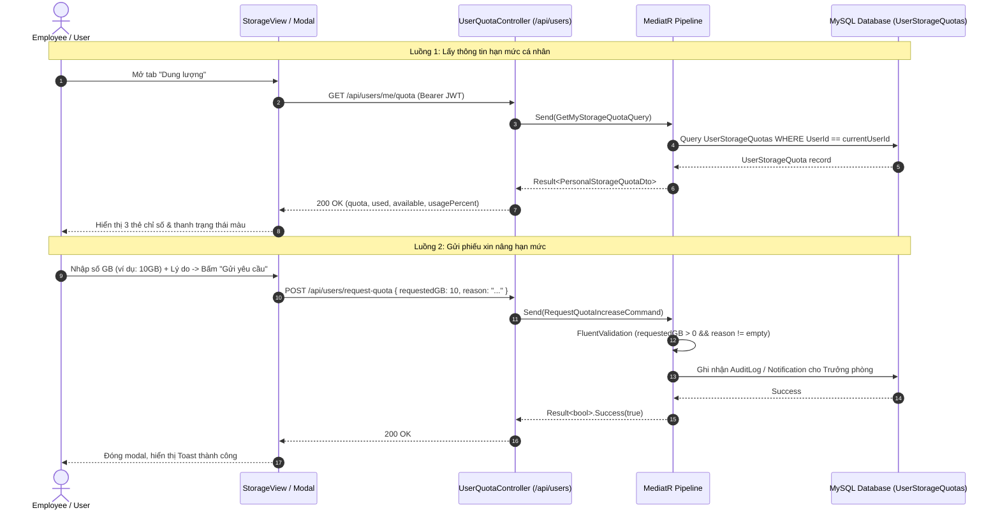

# PLAN: Get User Storage Quota & Increase Request (Quản lý Quota Cá nhân & Xin cấp thêm Dung lượng)

- **Feature Slug:** `get-user-storage-quota`
- **Module:** `User Portal`
- **Version:** `1.0.0`
- **Status:** `PENDING HUMAN REVIEW`
- **Plan Depth:** `DETAILED`
- **Decision Owner:** Tech Lead (`@architecture-team`)

---

## 1. Architectural Approach

### 1.1 Mục tiêu Kỹ thuật
Cung cấp khả năng hiển thị thời gian thực hạn mức lưu trữ cá nhân (`UserStorageQuota`) cho người dùng cuối trên giao diện [StorageView.tsx](file:///d:/Ky%209/DoAn_2/Cloud-DMS-FE/src/features/user/views/StorageView.tsx) và cho phép người dùng gửi phiếu đề xuất xin cấp thêm dung lượng lưu trữ (`RequestQuotaIncrease`) gửi tới Trưởng phòng ban (`DepartmentAdmin`).

### 1.2 Mô hình Kiến trúc (Clean Architecture & CQRS)
1. **Tầng Backend (.NET 8 Clean Architecture):**
   - **Query `GetMyStorageQuotaQuery`:** Cho phép người dùng đã xác thực (mọi role có token) truy vấn bản ghi `UserStorageQuota` gắn với `UserId` của chính mình (`_currentUserService.UserId`). Trả về: `QuotaBytes`, `UsedBytes`, `AvailableBytes`, `UsagePercent`, `DepartmentName`.
   - **Command `RequestQuotaIncreaseCommand`:** Tiếp nhận yêu cầu tăng dung lượng (`RequestedGB`, `Reason`), kiểm tra dữ liệu đầu vào (FluentValidation), tạo bản ghi thông báo/AuditLog và ghi nhận yêu cầu vào CSDL để Trưởng phòng ban xem và phê duyệt.
   - **Controller Endpoint:** Bổ sung vào `UsersController` hoặc tạo `UserQuotaController`:
     - `GET /api/users/me/quota`: Lấy thông tin hạn mức cá nhân của người gọi.
     - `POST /api/users/request-quota`: Gửi phiếu yêu cầu nâng hạn mức.
2. **Tầng Frontend (React + TypeScript + TailwindCSS):**
   - Cập nhật [driveApi.ts](file:///d:/Ky%209/DoAn_2/Cloud-DMS-FE/src/features/user/api/driveApi.ts) bổ sung `userApi.getMyQuota` và chuẩn hóa `userApi.requestQuotaIncrease`.
   - Tích hợp dữ liệu thật vào [StorageView.tsx](file:///d:/Ky%209/DoAn_2/Cloud-DMS-FE/src/features/user/views/StorageView.tsx) thay thế các giá trị hardcode `1.0 TB`.
   - Cung cấp Modal "Yêu cầu tăng dung lượng" cho người dùng nhập số GB và lý do, hiển thị loading và toast thông báo kết quả.

---

## 2. REQ-to-Component Mapping

| Mã Requirement | Thành phần đảm nhiệm | Layer | Đường dẫn tệp tin |
| :--- | :--- | :--- | :--- |
| **EARS-QT-01** | `GetMyStorageQuotaQueryHandler` | Application (CQRS Query) | `CleanArchCqrs.Application/Features/Users/Queries/GetMyStorageQuota/GetMyStorageQuotaQueryHandler.cs` |
| **EARS-QT-01** | `UserQuotaController.GetMyQuota` | Presentation (API) | `CleanArchCqrs.API/Controllers/UserQuotaController.cs` |
| **EARS-QT-01** | `StorageView.tsx` | Frontend (UI Component) | `Cloud-DMS-FE/src/features/user/views/StorageView.tsx` |
| **EARS-QT-02** | `StorageView.tsx` (Progress bar coloring) | Frontend (UI logic) | `Cloud-DMS-FE/src/features/user/views/StorageView.tsx` |
| **EARS-QT-03** | `RequestQuotaIncreaseCommandHandler` | Application (CQRS Command) | `CleanArchCqrs.Application/Features/Users/Commands/RequestQuotaIncrease/RequestQuotaIncreaseCommandHandler.cs` |
| **EARS-QT-03** | `UserQuotaController.RequestQuota` | Presentation (API) | `CleanArchCqrs.API/Controllers/UserQuotaController.cs` |
| **EARS-QT-03** | `RequestQuotaModal.tsx` | Frontend (Modal UI) | `Cloud-DMS-FE/src/features/user/components/RequestQuotaModal.tsx` |
| **EARS-QT-04** | `RequestQuotaIncreaseCommandValidator` | Application (Validation) | `CleanArchCqrs.Application/Features/Users/Commands/RequestQuotaIncrease/RequestQuotaIncreaseCommandValidator.cs` |

---

## 3. Data Flow



---

## 4. State-Change Classification

| Thành phần / Luồng | Phân loại State-change | Yêu cầu Checkpoint |
| :--- | :--- | :--- |
| `GET /api/users/me/quota` | `none` (Read-only query) | Không cần transaction, chỉ đọc dữ liệu theo `UserId`. |
| `POST /api/users/request-quota` | `business-data mutation` | Lưu bản ghi yêu cầu hoặc `AuditLog` với `Action = "RequestQuotaIncrease"`. |

---

## 5. Shared-Contract Impact
- **DTO mới phía Backend:** `PersonalStorageQuotaDto(Guid UserId, string FullName, long QuotaBytes, long UsedBytes, long AvailableBytes, double UsagePercent, string? DepartmentName)`.
- **API Interface phía Frontend:** Bổ sung phương thức vào [driveApi.ts](file:///d:/Ky%209/DoAn_2/Cloud-DMS-FE/src/features/user/api/driveApi.ts):
  ```typescript
  getMyQuota: async (): Promise<PersonalStorageQuotaDto> => {
    const res = await axiosClient.get('/users/me/quota');
    return res.data?.value || res.data;
  }
  ```

---

## 6. Consistency Map

| Requirement | Plan Component | Expected Task | Verification Command |
| :--- | :--- | :--- | :--- |
| `EARS-QT-01` | `GetMyStorageQuotaQueryHandler` | Viết Query & Handler trả về quota cá nhân | `dotnet test --filter "FullyQualifiedName~GetMyStorageQuota"` |
| `EARS-QT-02` | `StorageView.tsx` | Hiển thị màu vàng khi >=80%, đỏ khi >=95% | Kiểm tra giao diện người dùng |
| `EARS-QT-03` | `RequestQuotaIncreaseCommandHandler` | Viết Command & Controller endpoint | `dotnet test --filter "FullyQualifiedName~RequestQuotaIncrease"` |
| `EARS-QT-04` | `RequestQuotaIncreaseCommandValidator` | FluentValidation chặn số âm, rỗng | `dotnet test --filter "FullyQualifiedName~RequestQuotaValidator"` |

---

## 7. Dependencies & Execution Order
1. **Backend Foundation:**
   - Tạo DTO `PersonalStorageQuotaDto`.
   - Tạo `GetMyStorageQuotaQuery` và `GetMyStorageQuotaQueryHandler`.
   - Tạo `RequestQuotaIncreaseCommand`, `Validator` và `Handler`.
   - Đăng ký Route trong `UserQuotaController.cs`.
2. **Frontend Integration:**
   - Khai báo kiểu dữ liệu trong `src/features/user/types/index.ts`.
   - Cập nhật `driveApi.ts` gọi đúng endpoint backend.
   - Ghép nối dữ liệu vào `StorageView.tsx`.
   - Tạo component modal `RequestQuotaModal.tsx`.

---

## 8. Technical Risks & Mitigations

| STT | Rủi ro kỹ thuật | Mức độ | Biện pháp giảm thiểu (Mitigation) |
| :--- | :--- | :--- | :--- |
| 1 | Tài khoản mới tạo chưa được cấp bản ghi `UserStorageQuota` trong CSDL | Vừa | Handler tự động kiểm tra: Nếu `userQuota == null`, fallback lấy hạn mức mặc định của phòng ban hoặc trả về 0 Byte kèm thông báo liên hệ quản trị viên, không gây sập lỗi 500 NullReference. |
| 2 | Người dùng spam bấm gửi yêu cầu nâng Quota liên tục | Vừa | Áp dụng Rate Limiting trên endpoint `POST /api/users/request-quota` và vô hiệu hóa nút Submit trên UI khi đang gửi request. |
| 3 | Dung lượng trả về đơn vị Bytes nhưng giao diện hiển thị GB | Thấp | Cung cấp hàm định dạng chuẩn `FormatBytes` chia theo bội số 1024 để đảm bảo hiển thị thống nhất trên toàn hệ thống. |

---

## 9. Questions for Human Reviewer

### Q1: Hành vi khi tài khoản chưa có bản ghi UserStorageQuota
- **Điều chưa rõ:** Khi tài khoản nhân viên mới được tạo mà Trưởng phòng chưa kịp cấp Quota riêng, hệ thống nên hiển thị quota = 0 hay lấy theo quota phòng ban?
- **Assumption hiện tại:** Nếu chưa có bản ghi `UserStorageQuota` riêng, hệ thống hiển thị Quota cá nhân là 0 GB và hiển thị thông báo: `"Bạn chưa được phân bổ hạn mức lưu trữ riêng. Vui lòng liên hệ Trưởng phòng ban."`
- **Ảnh hưởng nếu sai:** Cần đổi sang đọc hạn mức dùng chung của phòng ban.
- **Câu hỏi cụ thể:** Bạn có đồng ý với assumption hiển thị 0 GB khi chưa được cấp riêng không?
- **Phản hồi từ User:** Khi tạo người dùng thì DepartmentAdmin đã bắt buộc phải cấp quota (nếu không cấp thì không tạo được user). Do đó bản ghi UserStorageQuota luôn tồn tại; nếu không tìm thấy sẽ trả về lỗi bản ghi không tồn tại. Chức năng gửi request tăng quota hiện tại chưa cần triển khai.

---

## 10. AI Recommendation và Human Final Review

### AI Recommendation
- **Status:** `APPROVED`
- **Đề xuất:** Phê duyệt `PLAN.md` cho feature `get-user-storage-quota` để tiến hành sinh task và triển khai mã nguồn.

### Human Final Review
- **Status:** `APPROVED`
- **Reviewer:** User
- **Decision Note:** Đã phê duyệt phương án: Tập trung vào endpoint GET /api/users/me/quota và hiển thị StorageView; tạm thời lược bỏ chức năng gửi request quota increase.
- **Timestamp:** 2026-10-14T18:45:00+07:00

