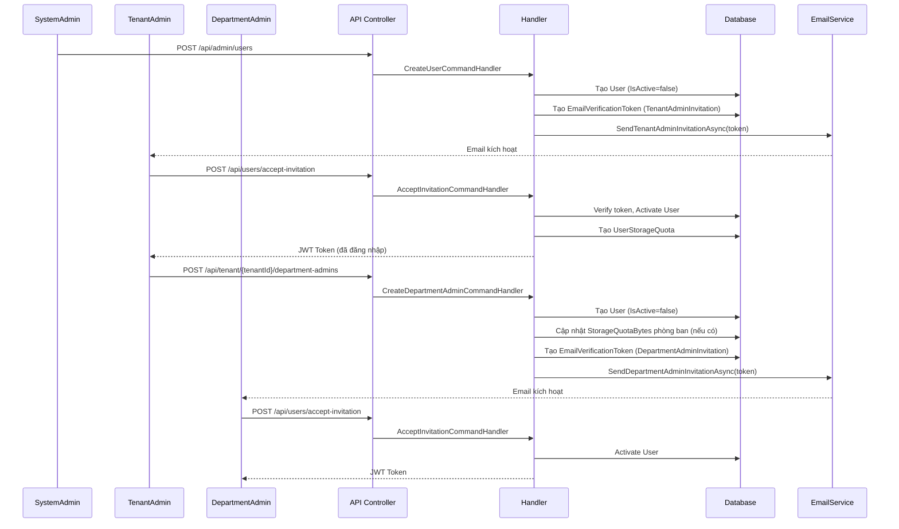

# 00 – Tổng quan Hệ thống & Mô hình Quota

## 1. Kiến trúc tổng thể

Dự án được xây dựng theo **Clean Architecture + CQRS (Command Query Responsibility Segregation)** sử dụng thư viện **MediatR**.

```
CleanArchCqrs.API            ← HTTP Endpoints (Controllers)
CleanArchCqrs.Application    ← Business Logic (Commands, Queries, Handlers)
CleanArchCqrs.Domain         ← Entities, Domain Rules
CleanArchCqrs.Infrastructure ← EF Core DbContext, Services (Email, JWT, Storage...)
```

### Luồng xử lý mỗi Request

```
Client Request
  → Controller (API Layer)
    → MediatR.Send(Command/Query)
      → Validator (FluentValidation)
        → Handler (Application Layer)
          → IApplicationDbContext (EF Core)
            → Database (SQL Server)
```

---

## 2. Hệ thống phân quyền (Role-Based)

Hệ thống có **4 Role cố định** (hardcoded trong CSDL):

| Role | Mô tả |
|------|--------|
| `SystemAdmin` | Quản trị toàn hệ thống |
| `TenantAdmin` | Quản trị viên Tổ chức (Công ty) |
| `DepartmentAdmin` | Trưởng phòng |
| `Employee` | Nhân viên |

**Các class liên quan:**
- `Role` – Entity vai trò → `src/CleanArchCqrs.Domain/Entities/Role.cs`
- `UserRole` – Bảng liên kết User ↔ Role (N-N) → `src/CleanArchCqrs.Domain/Entities/UserRole.cs`
- `Permission` – Quyền hạn chi tiết → `src/CleanArchCqrs.Domain/Entities/Permission.cs`
- `RolePermission` – Bảng liên kết Role ↔ Permission → `src/CleanArchCqrs.Domain/Entities/RolePermission.cs`

---

## 3. Mô hình Quota (Dung lượng lưu trữ)

### Cấu trúc phân cấp Quota

```
StorageProvider (Cloud: GDrive / OneDrive / Local)
  └── TotalCapacityBytes  ← Dung lượng vật lý của cloud
  └── UsedCapacityBytes   ← Đã sử dụng thực tế

Tenant (Tổ chức)
  └── StorageQuotaBytes   ← Quota được SystemAdmin cấp từ StorageProvider
  └── StorageUsedBytes    ← Tổng dung lượng thực tế tất cả file của Tenant

Department (Phòng ban)
  └── StorageQuotaBytes   ← Quota được TenantAdmin cấp từ Tenant
  └── StorageUsedBytes    ← Tổng dung lượng thực tế file của Phòng ban

UserStorageQuota (Quota cá nhân)
  └── QuotaBytes          ← Quota được DepartmentAdmin cấp từ Department
  └── UsedBytes           ← Dung lượng thực tế user đã upload
```

### Các Entity liên quan

| Entity | File | Vai trò |
|--------|------|---------|
| `StorageProvider` | `Domain/Entities/StorageProvider.cs` | Kho lưu trữ vật lý |
| `Tenant` | `Domain/Entities/Tenant.cs` | Tổ chức |
| `Department` | `Domain/Entities/Department.cs` | Phòng ban |
| `UserStorageQuota` | `Domain/Entities/UserStorageQuota.cs` | Quota cá nhân user |
| `FileEntry` | `Domain/Entities/FileEntry.cs` | Thông tin file đã upload |

### Quy tắc kiểm tra Quota khi upload file

Khi một user upload file, `UploadFileCommandHandler` kiểm tra **3 lớp**:

1. **User Quota** – `UserStorageQuota.UsedBytes + FileSize <= QuotaBytes` _(bắt buộc, chặn upload nếu vi phạm)_
2. **Cloud Provider Capacity** – `Provider.UsedCapacityBytes + FileSize <= TotalCapacityBytes`
3. _(Department & Tenant quota KHÔNG chặn upload, chỉ cập nhật UsedBytes sau khi upload thành công)_

---

## 4. Mô hình "Admin-First / Self-Setup" cho Department Admin

```
TenantAdmin tạo DepartmentAdmin
  → Cấp trước một "túi" Quota (UserStorageQuota)
  → Gửi Email mời kích hoạt

DepartmentAdmin kích hoạt tài khoản (AcceptInvitation)
  → Đặt mật khẩu mới
  → Đăng nhập hệ thống

DepartmentAdmin tự thiết lập phòng ban (SetupDepartment)
  → Tạo Department mới
  → Chuyển Quota từ "túi" sang Department
  → Quyết định giữ lại bao nhiêu Quota cho cá nhân
```

---

## 5. Sequence Diagram – Luồng Email Invitation Tổng quan



---

## 6. Các Interface quan trọng

| Interface | Triển khai | File | Mô tả |
|-----------|-----------|------|-------|
| `IApplicationDbContext` | `ApplicationDbContext` | `Infrastructure/Persistence/ApplicationDbContext.cs` | Truy cập CSDL qua EF Core |
| `ICurrentUserService` | `CurrentUserService` | `Infrastructure/Services/CurrentUserService.cs` | Lấy UserId/TenantId từ JWT claim |
| `IPasswordHasher` | `PasswordHasher` | `Infrastructure/Services/PasswordHasher.cs` | Hash/Verify mật khẩu BCrypt |
| `IJwtTokenService` | `JwtTokenService` | `Infrastructure/Services/JwtTokenService.cs` | Sinh JWT access token |
| `IEmailService` | `EmailService` | `Infrastructure/Services/EmailService.cs` | Gửi email qua SMTP/Gmail |
| `IStorageServiceFactory` | `StorageServiceFactory` | `Infrastructure/Storage/StorageServiceFactory.cs` | Tạo service lưu trữ theo loại provider |
| `IVirusScannerService` | `ClamAvScannerService` | `Infrastructure/Services/ClamAvScannerService.cs` | Quét virus ClamAV |
