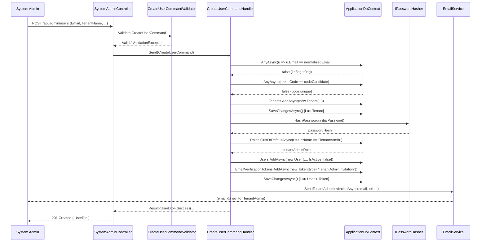
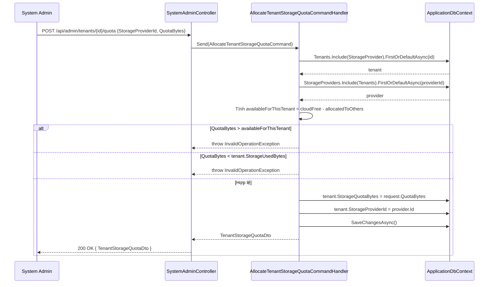
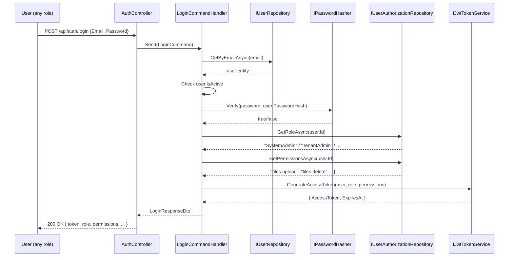

# 01 – Role: System Admin

**System Admin** là người quản trị toàn bộ hệ thống Cloud-DMS. Đây là role cao nhất, không thuộc về bất kỳ Tenant hay Department nào.

---

## Danh sách chức năng

| Chức năng | Method | Endpoint |
|-----------|--------|----------|
| Tạo Tenant Admin (kèm Tenant) | POST | `/api/admin/users` |
| Cấp Quota lưu trữ cho Tenant | POST | `/api/admin/tenants/{id}/quota` |
| Quản lý Cloud Storage Provider | POST/GET | `/api/admin/storage-providers` |
| Xem danh sách tất cả Users | GET | `/api/admin/users` |
| Xem AuditLog hệ thống | GET | `/api/admin/audit-logs` |

---

## Luồng 1: Tạo Tenant Admin (kèm tự động tạo Tenant mới)

### Các class tham gia

| Class | File | Vai trò |
|-------|------|---------|
| `UsersController` | `API/Controllers/Admin/UsersController.cs` | Nhận HTTP Request |
| `CreateUserCommand` | `Application/Features/SystemAdmin/Commands/CreateUser/CreateUserCommand.cs` | DTO Command |
| `CreateUserCommandValidator` | `Application/Features/SystemAdmin/Commands/CreateUser/CreateUserCommandValidator.cs` | Validate đầu vào (FluentValidation) |
| `CreateUserCommandHandler` | `Application/Features/SystemAdmin/Commands/CreateUser/CreateUserCommandHandler.cs` | **Logic chính** |
| `IApplicationDbContext` | `Application/Common/Interfaces/IApplicationDbContext.cs` | Interface truy cập DB |
| `IPasswordHasher` | `Application/Common/Interfaces/IPasswordHasher.cs` | Hash mật khẩu |
| `IEmailService` | `Application/Common/Interfaces/IEmailService.cs` | Gửi email |
| `EmailService` | `Infrastructure/Services/EmailService.cs` | Triển khai gửi email SMTP |
| `User` | `Domain/Entities/User.cs` | Entity người dùng |
| `Tenant` | `Domain/Entities/Tenant.cs` | Entity tổ chức |
| `UserRole` | `Domain/Entities/UserRole.cs` | Liên kết User ↔ Role |
| `EmailVerificationToken` | `Domain/Entities/EmailVerificationToken.cs` | Token kích hoạt email |
| `UserDto` | `Application/Features/SystemAdmin/DTOs/UserDto.cs` | Đối tượng trả về |

### Các bước xử lý trong `CreateUserCommandHandler`

**Bước 1 – Kiểm tra trùng email:**
```csharp
var emailExists = await _context.Users
    .AnyAsync(u => u.Email.ToLower() == normalizedEmail, cancellationToken);
```

**Bước 2 – Tự động sinh mã Tenant Code & tạo Tenant:**
```csharp
// Sinh code từ tên Tenant (lấy tối đa 8 ký tự chữ/số)
var codeCandidate = cleanLetters.Length > 8 ? cleanLetters[..8] : cleanLetters;

// Kiểm tra trùng code, nếu trùng thêm suffix ngẫu nhiên
var codeExists = await _context.Tenants.AnyAsync(t => t.Code == codeCandidate, ...);

tenant = new Tenant(Guid.NewGuid(), request.TenantName.Trim(), codeCandidate, quotaBytes: 0);
await _context.Tenants.AddAsync(tenant, cancellationToken);
await _context.SaveChangesAsync(cancellationToken); // Save Tenant trước để có ID
```

**Bước 3 – Xác định chế độ (Invitation / Direct):**
```csharp
// isInvitation = true nếu tạo kèm Tenant mới HOẶC không truyền mật khẩu
var isInvitation = !string.IsNullOrWhiteSpace(request.TenantName) || string.IsNullOrEmpty(request.Password);
var initialPassword = string.IsNullOrEmpty(request.Password) ? Guid.NewGuid().ToString("N") : request.Password;
```

**Bước 4 – Tạo User entity:**
```csharp
var user = new User
{
    Id = Guid.NewGuid(),
    Email = request.Email.Trim(),
    PasswordHash = _passwordHasher.HashPassword(initialPassword),
    TenantId = effectiveTenantId,
    IsActive = !isInvitation,       // false nếu là invitation
    EmailConfirmed = !isInvitation  // false nếu là invitation
};
```

**Bước 5 – Lấy Role "TenantAdmin" và gán:**
```csharp
var tenantAdminRole = await _context.Roles
    .FirstOrDefaultAsync(r => r.Name == "TenantAdmin", cancellationToken);

user.UserRoles.Add(new UserRole(Guid.NewGuid(), user.Id, tenantAdminRole.Id));
await _context.Users.AddAsync(user, cancellationToken);
```

**Bước 6 – Tạo EmailVerificationToken và gửi email (nếu là Invitation):**
```csharp
var tokenString = Guid.NewGuid().ToString("N") + Guid.NewGuid().ToString("N"); // 64 ký tự hex
var invitationToken = new EmailVerificationToken(
    id: Guid.NewGuid(),
    userId: user.Id,
    token: tokenString,
    tokenType: "TenantAdminInvitation",
    expirationHours: 48);

await _context.EmailVerificationTokens.AddAsync(invitationToken, cancellationToken);
await _context.SaveChangesAsync(cancellationToken);

await _emailService.SendTenantAdminInvitationAsync(
    toEmail: user.Email,
    recipientName: user.FullName,
    tenantName: tenant?.Name ?? "Tổ chức",
    token: tokenString,
    cancellationToken: cancellationToken);
```

### Sequence Diagram – Tạo Tenant Admin



---

## Luồng 2: Cấp Quota lưu trữ cho Tenant

### Các class tham gia

| Class | File | Vai trò |
|-------|------|---------|
| `SystemAdminController` | `API/Controllers/SystemAdmin/SystemAdminController.cs` | Nhận HTTP Request |
| `AllocateTenantStorageQuotaCommand` | `Application/Features/SystemAdmin/Commands/AllocateTenantStorageQuota/AllocateTenantStorageQuotaCommand.cs` | Command + **Handler (cùng file)** |
| `IApplicationDbContext` | `Application/Common/Interfaces/IApplicationDbContext.cs` | Truy cập DB |
| `Tenant` | `Domain/Entities/Tenant.cs` | Entity cập nhật Quota |
| `StorageProvider` | `Domain/Entities/StorageProvider.cs` | Kiểm tra dung lượng cloud |
| `TenantStorageQuotaDto` | `Application/Features/SystemAdmin/DTOs/TenantStorageQuotaDto.cs` | DTO trả về |

### Các bước xử lý trong `AllocateTenantStorageQuotaCommandHandler`

**Bước 1 – Tải Tenant và Provider:**
```csharp
var tenant = await _context.Tenants
    .Include(t => t.StorageProvider)
    .FirstOrDefaultAsync(t => t.Id == request.TenantId, cancellationToken);

var provider = await _context.StorageProviders
    .Include(sp => sp.Tenants)
    .FirstOrDefaultAsync(sp => sp.Id == request.StorageProviderId, cancellationToken);
```

**Bước 2 – Kiểm tra dung lượng khả dụng của Provider:**
```csharp
var totalCapacity = provider.TotalCapacityBytes > 0 ? provider.TotalCapacityBytes : (15L * 1024 * 1024 * 1024);
var cloudFree = Math.Max(0, totalCapacity - provider.UsedCapacityBytes);

// Trừ quota đã cấp cho các Tenant khác dùng cùng Provider
var allocatedToOthers = provider.Tenants
    .Where(t => t.Id != tenant.Id)
    .Sum(t => t.StorageQuotaBytes);

var availableForThisTenant = Math.Max(0, cloudFree - allocatedToOthers);

if (request.QuotaBytes > availableForThisTenant)
    throw new InvalidOperationException("Vượt quá dung lượng khả dụng của Cloud Provider!");
```

**Bước 3 – Không được hạ quota thấp hơn đã dùng:**
```csharp
if (request.QuotaBytes < tenant.StorageUsedBytes)
    throw new InvalidOperationException("Không thể cấp quota nhỏ hơn dung lượng đã sử dụng.");
```

**Bước 4 – Cập nhật và lưu:**
```csharp
tenant.StorageProviderId = provider.Id;
tenant.StorageQuotaBytes = request.QuotaBytes;
await _context.SaveChangesAsync(cancellationToken);
```

### Sequence Diagram – Cấp Quota cho Tenant



---

## Luồng 3: Đăng nhập (dùng chung cho tất cả Role)

### Các class tham gia

| Class | File | Vai trò |
|-------|------|---------|
| `AuthController` | `API/Controllers/Auth/AuthController.cs` | Nhận HTTP Request |
| `LoginCommand` | `Application/Users/Commands/Login/LoginCommand.cs` | Command DTO |
| `LoginCommandHandler` | `Application/Users/Commands/Login/LoginCommandHandler.cs` | Logic xử lý |
| `IUserRepository` | `Application/Common/Interfaces/Repositories/IUserRepository.cs` | Tìm user theo email |
| `IPasswordHasher` | `Application/Common/Interfaces/IPasswordHasher.cs` | Verify mật khẩu |
| `IJwtTokenService` | `Application/Common/Interfaces/IJwtTokenService.cs` | Sinh JWT token |
| `IUserAuthorizationRepository` | `Application/Common/Interfaces/Repositories/IUserAuthorizationRepository.cs` | Lấy Role + Permissions của User |
| `LoginResponseDto` | `Application/Users/DTOs/LoginResponseDto.cs` | DTO trả về |

### Các bước xử lý trong `LoginCommandHandler`

```csharp
// 1. Tìm user theo email
var user = await _userRepository.GetByEmailAsync(request.Email, cancellationToken);

// 2. Kiểm tra tài khoản có active không
if (!user.IsActive) throw new UnauthorizedAccessException("User account is inactive.");

// 3. Verify mật khẩu BCrypt
var passwordValid = _passswordHasher.Verify(request.Password, user.PasswordHash);

// 4. Lấy role và permissions để nhúng vào JWT claims
var role = await _userAuthorizationRepository.GetRoleAsync(user.Id, cancellationToken);
var permissions = await _userAuthorizationRepository.GetPermissionsAsync(user.Id, cancellationToken);

// 5. Sinh JWT Access Token
var token = _jwtTokenService.GenerateAccessToken(user, role, permissions);
```

### Sequence Diagram – Đăng nhập


