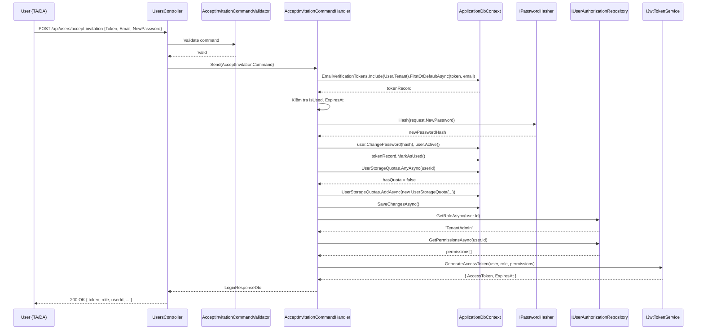
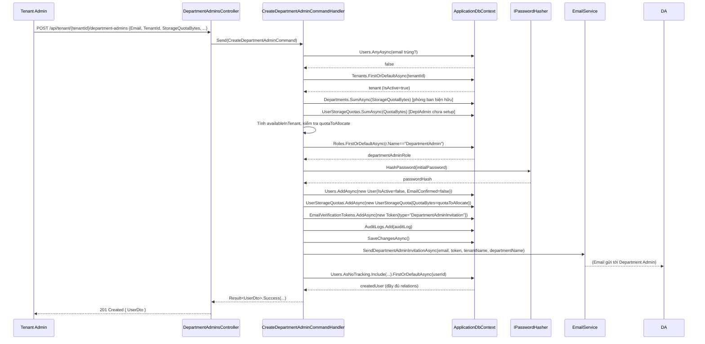
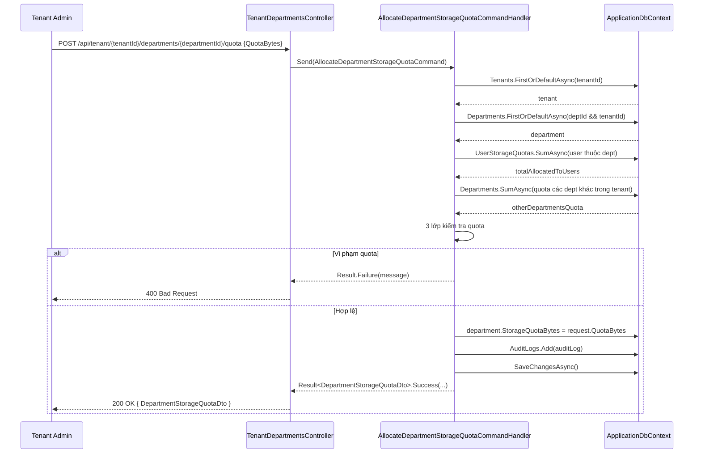

# 02 – Role: Tenant Admin

**Tenant Admin** là quản trị viên của một Tổ chức (Công ty). Được tạo bởi System Admin qua email invitation.

---

## Danh sách chức năng

| Chức năng | Method | Endpoint |
|-----------|--------|----------|
| Kích hoạt tài khoản (Accept Invitation) | POST | `/api/auth/accept-invitation` |
| Tạo Department Admin | POST | `/api/tenant/{tenantId}/department-admins` |
| Cấp Quota cho Phòng ban | POST | `/api/tenant/{tenantId}/departments/{departmentId}/quota` |
| Tạo/Quản lý Phòng ban | POST/GET/PUT | `/api/tenant/{tenantId}/departments` |
| Xem danh sách tệp & thống kê lưu trữ | GET | `/api/files` |

---

## Luồng 1: Kích hoạt tài khoản (Accept Invitation)

**Áp dụng cho:** TenantAdmin và DepartmentAdmin khi nhận email invitation.

### Các class tham gia

| Class | File | Vai trò |
|-------|------|---------|
| `AuthController` | `API/Controllers/AuthController.cs` | Nhận HTTP Request |
| `AcceptInvitationCommand` | `Application/Users/Commands/AcceptInvitation/AcceptInvitationCommand.cs` | Command DTO |
| `AcceptInvitationCommandValidator` | `Application/Users/Commands/AcceptInvitation/AcceptInvitationCommand.cs` | Validate (cùng file) |
| `AcceptInvitationCommandHandler` | `Application/Users/Commands/AcceptInvitation/AcceptInvitationCommand.cs` | **Logic chính** (cùng file) |
| `IApplicationDbContext` | `Application/Common/Interfaces/IApplicationDbContext.cs` | Truy cập DB |
| `IPasswordHasher` | `Application/Common/Interfaces/IPasswordHasher.cs` | Hash mật khẩu mới |
| `IJwtTokenService` | `Application/Common/Interfaces/IJwtTokenService.cs` | Sinh JWT sau khi activate |
| `IUserAuthorizationRepository` | `Application/Common/Interfaces/Repositories/IUserAuthorizationRepository.cs` | Lấy role/permissions |
| `EmailVerificationToken` | `Domain/Entities/EmailVerificationToken.cs` | Token xác minh |
| `UserStorageQuota` | `Domain/Entities/UserStorageQuota.cs` | Quota cá nhân (tự động tạo) |
| `LoginResponseDto` | `Application/Users/DTOs/LoginResponseDto.cs` | DTO trả về (đã login luôn) |

### Các bước xử lý trong `AcceptInvitationCommandHandler`

**Bước 1 – Xác minh token:**
```csharp
var tokenRecord = await _context.EmailVerificationTokens
    .Include(t => t.User).ThenInclude(u => u.Tenant)
    .FirstOrDefaultAsync(t => t.Token == request.Token.Trim()
                           && t.User.Email.ToLower() == normalizedEmail, cancellationToken);

if (tokenRecord == null) throw new KeyNotFoundException("Token không tồn tại.");
if (tokenRecord.IsUsed) throw new InvalidOperationException("Token đã được sử dụng.");
if (tokenRecord.ExpiresAt < DateTime.UtcNow) throw new InvalidOperationException("Token đã hết hạn.");
```

**Bước 2 – Kích hoạt tài khoản:**
```csharp
var user = tokenRecord.User;
user.ChangePassword(_passwordHasher.Hash(request.NewPassword)); // Đặt mật khẩu mới
user.Active();           // IsActive = true
user.EmailConfirmed = true;
tokenRecord.MarkAsUsed(); // IsUsed = true
```

**Bước 3 – Tạo UserStorageQuota nếu chưa có:**
```csharp
var hasQuota = await _context.UserStorageQuotas.AnyAsync(q => q.UserId == user.Id, cancellationToken);
if (!hasQuota && user.Tenant != null)
{
    var defaultQuotaBytes = user.Tenant.StorageQuotaBytes > 0
        ? user.Tenant.StorageQuotaBytes
        : 10L * 1024 * 1024 * 1024; // Mặc định 10 GB

    await _context.UserStorageQuotas.AddAsync(new UserStorageQuota
    {
        UserId = user.Id,
        QuotaBytes = defaultQuotaBytes,
        UsedBytes = 0
    }, cancellationToken);
}
await _context.SaveChangesAsync(cancellationToken);
```

**Bước 4 – Sinh JWT và trả về (đã login luôn):**
```csharp
var role = await _userAuthorizationRepository.GetRoleAsync(user.Id, cancellationToken) ?? "TenantAdmin";
var permissions = await _userAuthorizationRepository.GetPermissionsAsync(user.Id, cancellationToken);
var token = _jwtTokenService.GenerateAccessToken(user, role, permissions);
return new LoginResponseDto(token.AccessToken, token.ExpiresAt, user.Id, ...);
```

### Sequence Diagram – Accept Invitation



---

## Luồng 2: Tạo Department Admin

### Các class tham gia

| Class | File | Vai trò |
|-------|------|---------|
| `DepartmentAdminsController` | `API/Controllers/Tenant/DepartmentAdminsController.cs` | Nhận HTTP Request |
| `CreateDepartmentAdminCommand` | `Application/Features/TenantAdmin/Commands/CreateDepartmentAdmin/CreateDepartmentAdminCommand.cs` | Command DTO |
| `CreateDepartmentAdminCommandValidator` | `Application/Features/TenantAdmin/Commands/CreateDepartmentAdmin/CreateDepartmentAdminCommand.cs` | Validate (cùng file) |
| `CreateDepartmentAdminCommandHandler` | `Application/Features/TenantAdmin/Commands/CreateDepartmentAdmin/CreateDepartmentAdminCommandHandler.cs` | **Logic chính** |
| `IApplicationDbContext` | `Application/Common/Interfaces/IApplicationDbContext.cs` | Truy cập DB |
| `IPasswordHasher` | `Application/Common/Interfaces/IPasswordHasher.cs` | Hash mật khẩu |
| `IEmailService` | `Application/Common/Interfaces/IEmailService.cs` | Gửi email mời |
| `EmailService` | `Infrastructure/Services/EmailService.cs` | Gửi email qua SMTP |
| `User` | `Domain/Entities/User.cs` | Entity người dùng |
| `UserRole` | `Domain/Entities/UserRole.cs` | Gán role DepartmentAdmin |
| `UserStorageQuota` | `Domain/Entities/UserStorageQuota.cs` | "Túi Quota" tạm thời |
| `EmailVerificationToken` | `Domain/Entities/EmailVerificationToken.cs` | Token kích hoạt |
| `AuditLog` | `Domain/Entities/AuditLog.cs` | Lịch sử thao tác |
| `UserDto` | `Application/Features/SystemAdmin/DTOs/UserDto.cs` | DTO trả về |

### Các bước xử lý trong `CreateDepartmentAdminCommandHandler` (12 bước)

**Bước 1:** Kiểm tra email trùng lặp trong toàn hệ thống
**Bước 2:** Xác thực Tenant có tồn tại và đang active
**Bước 3:** Kiểm tra Department (nếu có truyền DepartmentId)
**Bước 4:** Tính toán Quota khả dụng của Tenant và phân bổ:
```csharp
long quotaToAllocate = request.StorageQuotaBytes ?? (1L * 1024 * 1024 * 1024); // Mặc định 1 GB

// Tổng quota đã cấp cho các phòng ban hiện hữu
var existingDeptsQuota = await _context.Departments
    .Where(d => d.TenantId == tenant.Id && ...)
    .SumAsync(d => d.StorageQuotaBytes, ...);

// Quota đang được giữ bởi các DeptAdmin chưa setup phòng
var pendingAdminsQuota = await _context.UserStorageQuotas
    .Where(q => q.User.TenantId == tenant.Id && q.User.DepartmentId == null)
    .SumAsync(q => q.QuotaBytes, ...);

var availableInTenant = tenant.StorageQuotaBytes - (existingDeptsQuota + pendingAdminsQuota);
if (quotaToAllocate > availableInTenant) return Result.Failure(...);
```

**Bước 5:** Tìm role "DepartmentAdmin" trong DB
**Bước 6:** Xác định chế độ (Invitation nếu mật khẩu để trống)
**Bước 7:** Tạo User entity + gán DepartmentAdmin role
**Bước 8:** Tạo `UserStorageQuota` – "túi giữ quota" tạm thời
**Bước 9:** Tạo `EmailVerificationToken` nếu là invitation
**Bước 10:** Ghi `AuditLog`
**Bước 11:** `SaveChangesAsync()` + gửi email
**Bước 12:** Load lại user đầy đủ relations để trả về DTO

### Sequence Diagram – Tạo Department Admin



---

## Luồng 3: Cấp Quota cho Phòng ban

### Các class tham gia

| Class | File | Vai trò |
|-------|------|---------|
| `TenantDepartmentsController` | `API/Controllers/Tenant/TenantDepartmentsController.cs` | Nhận HTTP Request |
| `AllocateDepartmentStorageQuotaCommand` | `Application/Features/TenantAdmin/Commands/AllocateDepartmentStorageQuota/AllocateDepartmentStorageQuotaCommand.cs` | Command + Handler (cùng file) |
| `IApplicationDbContext` | `Application/Common/Interfaces/IApplicationDbContext.cs` | Truy cập DB |
| `ICurrentUserService` | `Application/Common/Interfaces/ICurrentUserService.cs` | Lấy userId từ JWT |
| `Department` | `Domain/Entities/Department.cs` | Entity cập nhật Quota |
| `AuditLog` | `Domain/Entities/AuditLog.cs` | Ghi lịch sử |
| `DepartmentStorageQuotaDto` | `Application/Features/TenantAdmin/DTOs/DepartmentStorageQuotaDto.cs` | DTO trả về |

### Logic kiểm tra quota (3 lớp bảo vệ)

```csharp
// Lớp 1: Không hạ quota thấp hơn đã sử dụng
if (request.QuotaBytes < department.StorageUsedBytes)
    return Result.Failure("...");

// Lớp 2: Không hạ quota thấp hơn tổng quota đã cấp cho users
var totalAllocatedToUsers = await _context.UserStorageQuotas
    .Where(q => q.User.DepartmentId == department.Id)
    .SumAsync(q => q.QuotaBytes, cancellationToken);
if (request.QuotaBytes < totalAllocatedToUsers)
    return Result.Failure("...");

// Lớp 3: Không vượt quota khả dụng của Tenant
var otherDepartmentsQuota = await _context.Departments
    .Where(d => d.TenantId == tenant.Id && d.Id != department.Id)
    .SumAsync(d => d.StorageQuotaBytes, cancellationToken);
var availableInTenant = tenant.StorageQuotaBytes - otherDepartmentsQuota;
if (request.QuotaBytes > availableInTenant)
    return Result.Failure("...");
```

### Sequence Diagram – Cấp Quota cho Phòng ban


