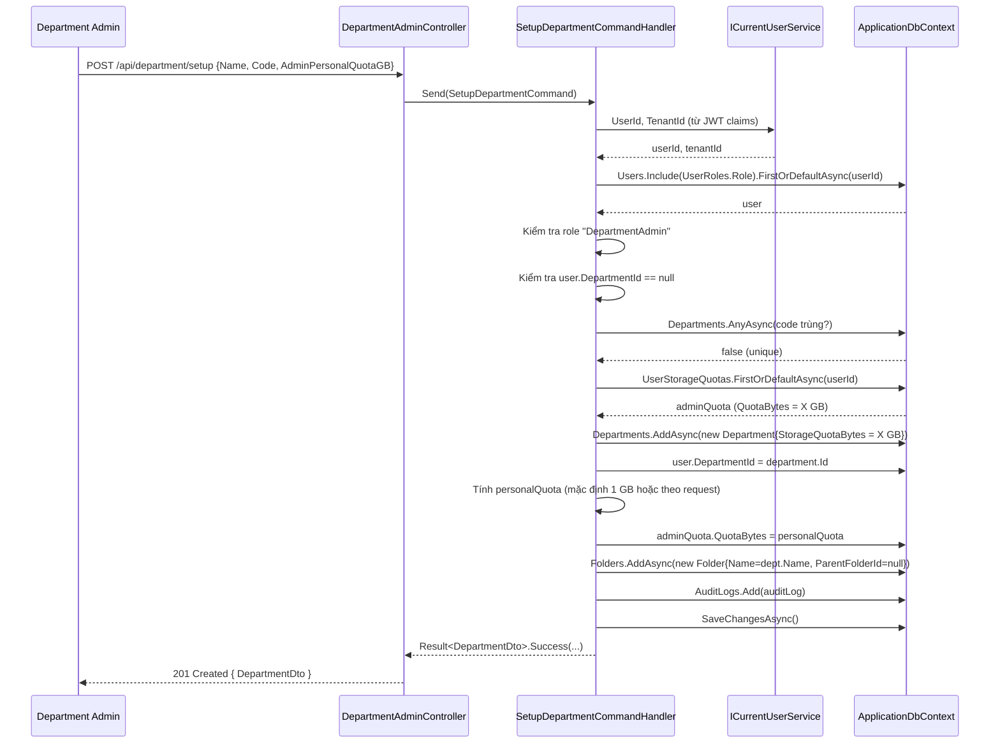
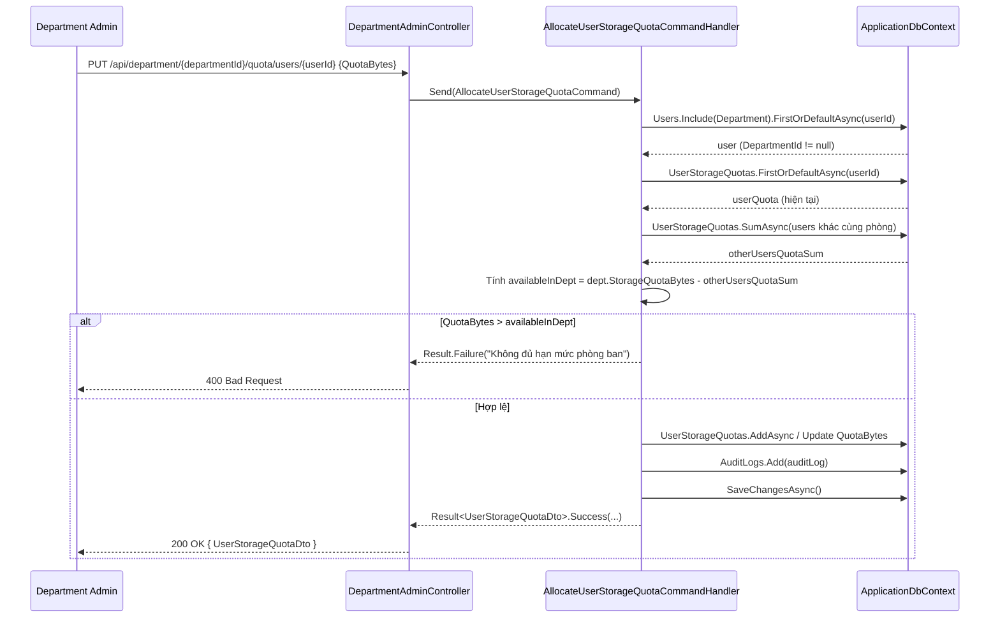

# 03 – Role: Department Admin (Trưởng phòng)

**Department Admin** là trưởng phòng ban, được tạo bởi Tenant Admin qua email invitation.  
Sau khi kích hoạt tài khoản, Department Admin tự thiết lập phòng ban của mình và quản lý Quota cho nhân viên.

---

## Danh sách chức năng

| Chức năng | Method | Endpoint |
|-----------|--------|----------|
| Kích hoạt tài khoản | POST | `/api/users/accept-invitation` |
| Tự thiết lập phòng ban | POST | `/api/department/setup` |
| Cấp Quota cho nhân viên | PUT | `/api/department/{departmentId}/quota/users/{userId}` |
| Xem Quota nhân viên phòng | GET | `/api/department/{departmentId}/quota/users` |
| Tạo nhân viên trong phòng | POST | `/api/department/{departmentId}/employees` |

> **Lưu ý:** Luồng kích hoạt tài khoản dùng chung `AcceptInvitationCommandHandler` như TenantAdmin.  
> Xem chi tiết ở [02_ROLE_TENANT_ADMIN.md – Luồng 1](./02_ROLE_TENANT_ADMIN.md).

---

## Luồng 1: Tự thiết lập phòng ban (SetupDepartment)

Sau khi kích hoạt tài khoản, nếu chưa có phòng ban, Department Admin phải gọi API này để tạo phòng ban.  
"Túi Quota" mà TenantAdmin đã cấp sẽ được chuyển thành Quota của phòng ban.

### Các class tham gia

| Class | File | Vai trò |
|-------|------|---------|
| `DepartmentAdminController` | `API/Controllers/DepartmentAdmin/DepartmentAdminController.cs` | Nhận HTTP Request |
| `SetupDepartmentCommand` | `Application/Features/DepartmentAdmin/Commands/SetupDepartment/SetupDepartmentCommand.cs` | Command DTO |
| `SetupDepartmentCommandHandler` | `Application/Features/DepartmentAdmin/Commands/SetupDepartment/SetupDepartmentCommand.cs` | **Logic chính** (cùng file) |
| `IApplicationDbContext` | `Application/Common/Interfaces/IApplicationDbContext.cs` | Truy cập DB |
| `ICurrentUserService` | `Application/Common/Interfaces/ICurrentUserService.cs` | Lấy userId từ JWT claim |
| `User` | `Domain/Entities/User.cs` | Entity người dùng (cập nhật DepartmentId) |
| `Department` | `Domain/Entities/Department.cs` | Entity phòng ban (mới tạo) |
| `UserStorageQuota` | `Domain/Entities/UserStorageQuota.cs` | Chuyển Quota từ "túi" sang cá nhân |
| `Folder` | `Domain/Entities/Folder.cs` | Tạo thư mục gốc tự động |
| `AuditLog` | `Domain/Entities/AuditLog.cs` | Ghi lịch sử |
| `DepartmentDto` | `Application/Features/TenantAdmin/DTOs/DepartmentDto.cs` | DTO trả về |

### Các bước xử lý trong `SetupDepartmentCommandHandler` (7 bước)

**Bước 1 – Lấy userId/tenantId từ JWT claim qua `ICurrentUserService`:**
```csharp
var userId = _currentUserService.UserId;
var tenantId = _currentUserService.TenantId;
if (!userId.HasValue || !tenantId.HasValue)
    return Result.Failure("Chưa xác thực danh tính.");
```

**Bước 2 – Kiểm tra quyền và trạng thái:**
```csharp
var user = await _context.Users
    .Include(u => u.Tenant)
    .Include(u => u.UserRoles).ThenInclude(ur => ur.Role)
    .FirstOrDefaultAsync(u => u.Id == userId.Value, cancellationToken);

// Kiểm tra đúng role DepartmentAdmin
var roles = user.UserRoles.Select(ur => ur.Role.Name).ToList();
if (!roles.Contains("DepartmentAdmin"))
    return Result.Failure("Chỉ DepartmentAdmin mới có quyền...");

// Kiểm tra chưa thuộc phòng ban nào
if (user.DepartmentId.HasValue)
    return Result.Failure("Tài khoản đã được gắn với một Phòng ban.");
```

**Bước 3 – Kiểm tra mã phòng ban trùng lặp:**
```csharp
var normalizedCode = request.Code.Trim().ToUpperInvariant();
var codeExists = await _context.Departments
    .AnyAsync(d => d.TenantId == tenantId.Value && d.Code == normalizedCode, cancellationToken);
```

**Bước 4 – Lấy Quota từ "túi" và tạo Department:**
```csharp
// Lấy quota đã được TenantAdmin cấp trước
var adminQuota = await _context.UserStorageQuotas
    .FirstOrDefaultAsync(q => q.UserId == user.Id, cancellationToken);

long departmentQuotaBytes = adminQuota?.QuotaBytes ?? (10L * 1024 * 1024 * 1024); // Mặc định 10 GB

var department = new Department
{
    Id = Guid.NewGuid(),
    TenantId = tenantId.Value,
    Name = request.Name.Trim(),
    Code = normalizedCode,
    StorageQuotaBytes = departmentQuotaBytes, // Chuyển hết quota vào phòng ban
    StorageUsedBytes = 0,
    IsActive = true
};
await _context.Departments.AddAsync(department, cancellationToken);
user.DepartmentId = department.Id; // Gắn DeptAdmin vào phòng ban vừa tạo
```

**Bước 5 – DeptAdmin tự chọn giữ lại quota cá nhân:**
```csharp
// DeptAdmin tự chỉ định giữ lại bao nhiêu (GB hoặc Bytes)
long personalQuota;
if (request.AdminPersonalQuotaGB.HasValue)
    personalQuota = (long)(request.AdminPersonalQuotaGB.Value * 1024 * 1024 * 1024);
else if (request.AdminPersonalQuotaBytes.HasValue)
    personalQuota = request.AdminPersonalQuotaBytes.Value;
else
    personalQuota = Math.Min(departmentQuotaBytes, 1L * 1024 * 1024 * 1024); // Mặc định 1 GB

// Cập nhật "túi quota" thành quota cá nhân
if (adminQuota != null)
    adminQuota.QuotaBytes = personalQuota;
```

**Bước 6 – Tạo thư mục gốc mặc định cho phòng ban:**
```csharp
var rootDeptFolder = new Folder
{
    Id = Guid.NewGuid(),
    TenantId = tenantId.Value,
    DepartmentId = department.Id,
    Name = department.Name,
    ParentFolderId = null // Thư mục gốc
};
await _context.Folders.AddAsync(rootDeptFolder, cancellationToken);
```

**Bước 7 – Ghi AuditLog và lưu:**
```csharp
var auditLog = new AuditLog
{
    Action = "SetupDepartment",
    Details = $"Trưởng phòng '{user.FullName}' tự thiết lập phòng '{department.Name}'. Tổng vùng nhớ: {FormatBytes(departmentQuotaBytes)}. Cá nhân giữ: {FormatBytes(personalQuota)}."
};
_context.AuditLogs.Add(auditLog);
await _context.SaveChangesAsync(cancellationToken);
```

### Sequence Diagram – Setup Department



---

## Luồng 2: Cấp Quota cho nhân viên

### Các class tham gia

| Class | File | Vai trò |
|-------|------|---------|
| `DepartmentAdminController` | `API/Controllers/DepartmentAdmin/DepartmentAdminController.cs` | Nhận HTTP Request |
| `AllocateUserStorageQuotaCommand` | `Application/Features/DepartmentAdmin/Commands/AllocateUserStorageQuota/AllocateUserStorageQuotaCommand.cs` | Command + Handler (cùng file) |
| `IApplicationDbContext` | `Application/Common/Interfaces/IApplicationDbContext.cs` | Truy cập DB |
| `ICurrentUserService` | `Application/Common/Interfaces/ICurrentUserService.cs` | Lấy userId caller |
| `User` | `Domain/Entities/User.cs` | User được cấp quota |
| `Department` | `Domain/Entities/Department.cs` | Kiểm tra quota phòng ban |
| `UserStorageQuota` | `Domain/Entities/UserStorageQuota.cs` | Tạo/cập nhật quota cá nhân |
| `AuditLog` | `Domain/Entities/AuditLog.cs` | Ghi lịch sử |
| `UserStorageQuotaDto` | `Application/Features/DepartmentAdmin/DTOs/UserStorageQuotaDto.cs` | DTO trả về |

### Logic kiểm tra quota (3 lớp bảo vệ)

```csharp
// Lớp 1: Không hạ quota thấp hơn đã dùng
if (userQuota != null && request.QuotaBytes < userQuota.UsedBytes)
    return Result.Failure("Không thể hạ hạn mức thấp hơn đã sử dụng.");

// Lớp 2: Tổng quota các user khác + quota mới <= quota phòng ban
var otherUsersQuotaSum = await _context.UserStorageQuotas
    .Where(q => q.User.DepartmentId == department.Id && q.UserId != user.Id)
    .SumAsync(q => q.QuotaBytes, cancellationToken);

var availableInDept = Math.Max(0, department.StorageQuotaBytes - otherUsersQuotaSum);
if (request.QuotaBytes > availableInDept)
    return Result.Failure("Phòng ban không còn đủ hạn mức!");

// Tạo hoặc cập nhật UserStorageQuota
if (userQuota == null)
    await _context.UserStorageQuotas.AddAsync(new UserStorageQuota {...});
else
    userQuota.QuotaBytes = request.QuotaBytes;
```

### Sequence Diagram – Cấp Quota cho nhân viên


