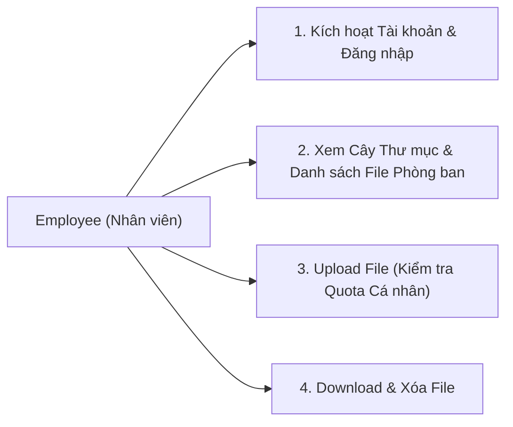

# CHI TIẾT CHỨC NĂNG VÀ LUỒNG CODE: ROLE EMPLOYEE (NHÂN VIÊN)

Vai trò **Employee** (Nhân viên) là người dùng cuối trực tiếp sản xuất, tải lên và thao tác với các tài liệu trong phạm vi phòng ban của mình. Mọi hành vi lưu trữ của nhân viên đều được bảo đảm bằng hạn mức cá nhân độc lập (Personal Quota).

---

## 1. Bản đồ Chức năng của Employee



---

## 2. Chi tiết từng Luồng Chức năng & Code tham gia

### LUỒNG 1: KÍCH HOẠT TÀI KHOẢN VÀ THAM GIA PHÒNG BAN

* **Mục đích**: Nhân viên mới nhận email mời từ hệ thống, tự đặt mật khẩu để kích hoạt tài khoản.
* **Controller**: [AuthController.cs](file:///d:/Ky%209/DoAn_2/Cloud-DMS/src/CleanArchCqrs.API/Controllers/AuthController.cs)
  * `POST /api/auth/accept-invitation`: Đặt mật khẩu và kích hoạt tài khoản.
* **Command & Handler**: [AcceptInvitationCommand.cs](file:///d:/Ky%209/DoAn_2/Cloud-DMS/src/CleanArchCqrs.Application/Users/Commands/AcceptInvitation/AcceptInvitationCommand.cs)
  * Xác thực `token` và `email` trong bảng `EmailVerificationTokens`.
  * Hash mật khẩu mới, kích hoạt `user.Active()`, `user.EmailConfirmed = true`.
  * Đánh dấu token đã dùng `tokenRecord.MarkAsUsed()`.
  * Trả về JWT Access Token để đăng nhập ngay mà không cần nhập lại mật khẩu.

---

### LUỒNG 2: XEM TÀI LIỆU VÀ THƯ MỤC TRONG PHÒNG BAN

* **Mục đích**: Nhân viên xem danh sách các tệp tin trong thư mục gốc của phòng ban hoặc các thư mục con được phân quyền.
* **Controller**: [FilesController.cs](file:///d:/Ky%209/DoAn_2/Cloud-DMS/src/CleanArchCqrs.API/Controllers/FilesController.cs#L76)
  * `GET /api/files?folderId={folderId}`
* **Query & Handler**: [GetTenantFilesQueryHandler.cs](file:///d:/Ky%209/DoAn_2/Cloud-DMS/src/CleanArchCqrs.Application/Features/Files/Queries/GetTenantFiles/GetTenantFilesQueryHandler.cs)
  * Lấy danh sách file đang hoạt động (`!f.IsDeleted`).
  * Trả về thông tin: Tên file, Dung lượng, Loại file (`ContentType`), Tên phòng ban (`DepartmentName`), Người upload (`OwnerName`), Ngày tạo.

---

### LUỒNG 3: UPLOAD TÀI LIỆU VÀO PHÒNG BAN (NGHIỆP VỤ CỐT LÕI)

* **Mục đích**: Nhân viên tải tài liệu mới lên hệ thống. Hệ thống kiểm tra dung lượng cá nhân và đẩy file lên kho lưu trữ đám mây.
* **Controller**: [FilesController.cs](file:///d:/Ky%209/DoAn_2/Cloud-DMS/src/CleanArchCqrs.API/Controllers/FilesController.cs#L36)
  * `POST /api/files/upload` (dạng `multipart/form-data`)
* **Command & Handler**: [UploadFileCommandHandler.cs](file:///d:/Ky%209/DoAn_2/Cloud-DMS/src/CleanArchCqrs.Application/Features/Files/Commands/UploadFile/UploadFileCommandHandler.cs)

**Quy trình xử lý Code 5 bước:**

1. **Xác định Phòng ban của Nhân viên**:
   ```csharp
   // Nhân viên bắt buộc phải thuộc một phòng ban
   var department = user.Department;
   if (department == null)
   {
       return Result<FileEntryDto>.Failure("Bạn chưa được phân công vào phòng ban nào. Không thể tải file lên.");
   }
   ```
2. **Kiểm tra Thư mục đích (`FolderId`)**:
   ```csharp
   // Thư mục đích phải thuộc về phòng ban của nhân viên
   if (targetFolder.DepartmentId.HasValue && targetFolder.DepartmentId.Value != department.Id)
   {
       return Result<FileEntryDto>.Failure("Thư mục đích không thuộc phòng ban của bạn.");
   }
   ```
3. **Kiểm tra Quota Cá nhân (Bỏ qua Quota Phòng ban)**:
   ```csharp
   var userQuota = await _context.UserStorageQuotas
       .FirstOrDefaultAsync(q => q.UserId == userId.Value, cancellationToken);

   // Chỉ kiểm tra hạn mức cá nhân đã được Trưởng phòng cấp
   if (userQuota != null && userQuota.QuotaBytes > 0 && userQuota.UsedBytes + request.FileSize > userQuota.QuotaBytes)
   {
       return Result<FileEntryDto>.Failure(
           $"Hết dung lượng cá nhân được cấp! (Đã dùng: {FormatBytes(userQuota.UsedBytes)} / Hạn mức: {FormatBytes(userQuota.QuotaBytes)}). Vui lòng liên hệ Trưởng phòng để được cấp thêm.");
   }
   ```
4. **Tải tệp lên Cloud Storage (Google Drive / Local Storage)**:
   ```csharp
   var storageResult = await _storageService.UploadFileAsync(uploadContext, cancellationToken);
   ```
5. **Lưu FileEntry & Tự động cộng dồn dung lượng**:
   ```csharp
   var fileEntry = new FileEntry(
       Guid.NewGuid(),
       tenant.Id,
       userId.Value,
       request.FileName,
       storageResult.StorageKey,
       request.ContentType,
       request.FileSize,
       request.FolderId,
       department.Id, // Luôn gắn DepartmentId vào File
       provider.Id);

   await _context.FileEntries.AddAsync(fileEntry, cancellationToken);

   // Cộng dồn 3 cấp
   if (userQuota != null) userQuota.UsedBytes += request.FileSize;
   department.StorageUsedBytes += request.FileSize;
   tenant.StorageUsedBytes += request.FileSize;

   await _context.SaveChangesAsync(cancellationToken);
   ```

---

### LUỒNG 4: DOWNLOAD VÀ XÓA TÀI LIỆU

* **Tải file ([DownloadFileQueryHandler.cs](file:///d:/Ky%209/DoAn_2/Cloud-DMS/src/CleanArchCqrs.Application/Features/Files/Queries/DownloadFile/DownloadFileQueryHandler.cs))**:
  * `GET /api/files/{id}/download`
  * Đọc `StorageKey` từ CSDL, gọi `IStorageService.DownloadFileAsync` để kéo luồng nhị phân (Stream) từ Google Drive / Local Storage trả về cho người dùng tải xuống.

* **Xóa file ([DeleteFileCommandHandler.cs](file:///d:/Ky%209/DoAn_2/Cloud-DMS/src/CleanArchCqrs.Application/Features/Files/Commands/DeleteFile/DeleteFileCommandHandler.cs))**:
  * `DELETE /api/files/{id}`
  * Đánh dấu xóa mềm `fileEntry.IsDeleted = true`.
  * Trừ hoàn lại dung lượng đã giải phóng trên cả 3 cấp:
    ```csharp
    userQuota.UsedBytes = Math.Max(0, userQuota.UsedBytes - fileEntry.SizeBytes);
    department.StorageUsedBytes = Math.Max(0, department.StorageUsedBytes - fileEntry.SizeBytes);
    tenant.StorageUsedBytes = Math.Max(0, tenant.StorageUsedBytes - fileEntry.SizeBytes);
    ```
