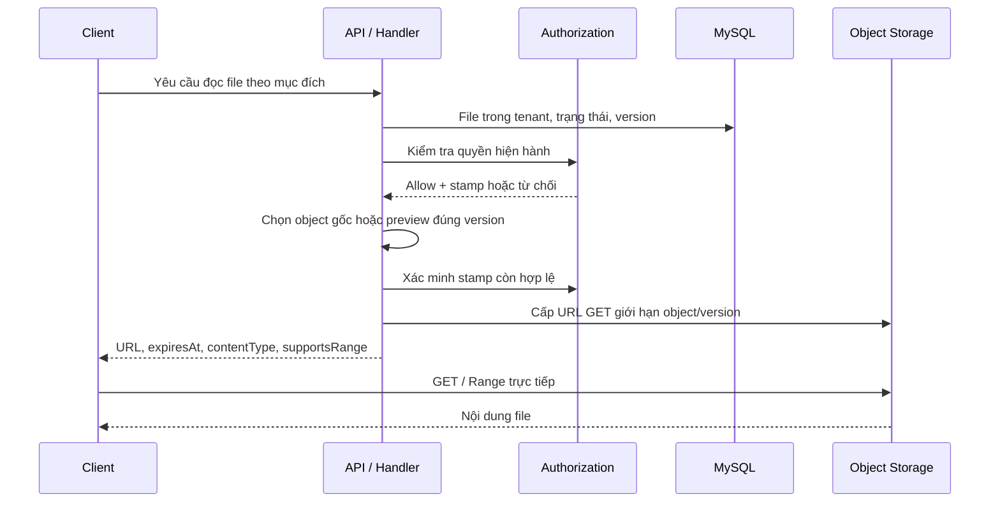
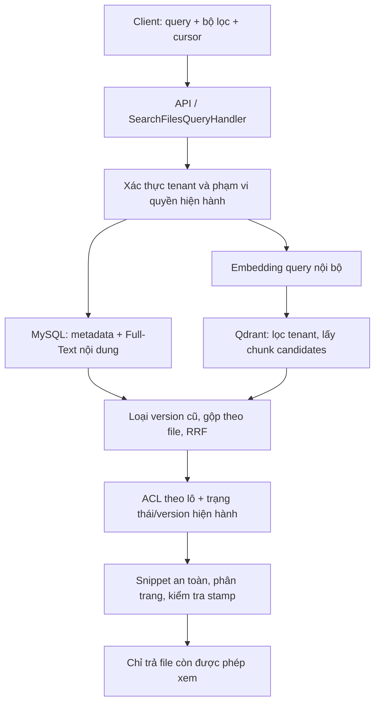

# Thiết kế luồng Read File và Search File

Ngày: 13/10/2026. Trạng thái: **đề xuất để review, chưa triển khai**.

Căn cứ: [spec](../spec/CloudDMS_Search_Read_Spec.md), [kiến trúc](../../ARCHITECTURE.md), [bảo mật](../../SECURITY.md) và mã nguồn hiện tại. Mục tiêu Release 1 là tìm từ khóa/ngữ nghĩa, rồi download, preview hoặc streaming file đúng quyền và đúng phiên bản. Không bao gồm OCR, transcript, HLS hoặc huấn luyện model.

## 1. Hiện trạng và phần cần bổ sung

| Hiện có trong mã nguồn | Khoảng trống so với spec |
|---|---|
| `FilesController`, `DownloadFileQuery` trả stream từ storage qua backend | Chưa có presigned URL/direct download; upload hiện đi qua API, giới hạn 100 MB |
| `IStorageService`, factory Local/Google Drive/OneDrive | Chưa có adapter Object Storage và khai báo khả năng signed URL/Range |
| `FileEntry`, `FileShare`, `Folder` | Chưa đủ ACL team/kế thừa thư mục, version nội dung và trạng thái index/preview |
| Download kiểm tra tenant/role; danh sách kiểm tra tenant | Chưa nối evaluator mới; danh sách chưa lọc ACL từng file; `SearchTerm` và phân trang chưa được handler áp dụng |
| `IAuthorizationService`, snapshot, stamp và kiểm tra lại quyền | Evaluator hiện hỗ trợ owner/share trực tiếp; cần mở rộng ACL và kiểm tra theo lô |
| Outbox/worker cho authorization | Chưa có pipeline search, extraction, embedding, Qdrant và preview |

Đặc biệt, `AuthorizationOutboxWorker` hiện đọc mọi outbox chưa publish và tìm authorization operation tương ứng. Không ghi sự kiện indexing vào bảng này với cơ chế hiện tại: đề xuất một outbox riêng cho tài liệu, tránh worker authorization nhận nhầm sự kiện.

## 2. Phương án và kiến trúc đề xuất

Chọn **MySQL Full-Text + Qdrant, hợp nhất bằng Reciprocal Rank Fusion (RRF)**. RRF dựa trên thứ hạng nên không cần coi điểm keyword và cosine là cùng một thang đo. Đây là đề xuất cho câu hỏi mở trong spec.

Hai phương án khác: chuẩn hóa điểm rồi cộng trọng số cần dữ liệu hiệu chỉnh; chỉ chạy keyword trước sẽ đơn giản hơn nhưng chưa đạt đủ GD2 của Release 1. Không dùng hai phương án này làm thiết kế mặc định.

| Tầng | Trách nhiệm dự kiến |
|---|---|
| API | Xác thực, validation đầu vào, ánh xạ HTTP; không chứa thuật toán search/ACL |
| Application | Query/command và handler điều phối read/search/preview, hợp nhất/xếp hạng, kiểm tra quyền |
| Domain | Entity/version/trạng thái file, ACL và dữ liệu vòng đời indexing/preview |
| Infrastructure | MySQL Full-Text, Qdrant, embedding nội bộ, Object Storage, converter, extractor, worker |

Interface mới đặt trong `Application/Common/Interfaces`: `IKeywordSearchService`, `IVectorSearchService`, `IEmbeddingService`, `IFileTextExtractor`, `IPreviewProvider`, `IObjectReadUrlService`. Mở rộng cơ chế authorization hiện có để hỗ trợ kiểm tra theo lô và ACL kế thừa; không tạo một bộ quy tắc quyền độc lập cho search.

Các adapter cần khai báo capability. Provider không hỗ trợ direct read/Range phải trả trạng thái không hỗ trợ; không quảng bá khả năng đọc file lớn theo spec khi vẫn cần proxy qua backend.

## 3. Điều kiện truy cập dùng chung

Read và search sử dụng cùng một chính sách:

1. Xác định user/session/tenant từ ngữ cảnh đã xác thực; không nhận tenant tùy ý từ client.
2. Kiểm tra phiên/user đang hoạt động và quyền hành động, sau đó ACL file: owner, share trực tiếp còn hạn, team hoặc kế thừa thư mục.
3. Chỉ cho truy cập file `Active`, không bị xóa và đã được xác nhận an toàn. Scan chưa chạy, bị tắt hoặc lỗi không được mặc nhiên coi là sạch.
4. MySQL là nguồn chuẩn. Snapshot quyền chỉ dùng khi generation/version còn hợp lệ và không có mutation đang pending. Thiếu dữ liệu quyền hoặc Redis bảo mật không sẵn sàng thì từ chối tạm thời, không fallback sang claim JWT cũ.
5. Kiểm tra lại authorization stamp và trạng thái/version hiện hành sát thời điểm trả dữ liệu hoặc cấp URL. Mutation file/share/folder/team phải tham gia cơ chế version/coordinator để phát hiện thay đổi đồng thời.

ACL team và thư mục là phần cần bổ sung. Đề xuất quyền hiệu lực là hợp các grant còn hiệu lực; Viewer đọc, preview, tải và stream; Editor thêm cập nhật; Owner thêm quản lý chia sẻ/xóa. Chưa thêm explicit deny. Ma trận này cần xác nhận vì spec chưa chốt.

Không suy luận quyền nội dung từ vai trò admin. Cần thống nhất handler download cũ với evaluator hiện có về SystemAdmin và truy cập xuyên tenant. Public link có luồng riêng; sở hữu link không tự làm file xuất hiện trong search của người ngoài.

## 4. Luồng Read File



### Download và streaming

- Query `GetFileReadAccessQuery` nhận `FileId` và mục đích `download`, `inline` hoặc `stream` trong danh sách cho phép.
- Storage key lấy từ MySQL, không nhận từ client. Mỗi version dùng object key bất biến; thay nội dung tạo object mới.
- Download dùng `Content-Disposition: attachment`; inline chỉ dành cho MIME được cho phép, dùng origin phục vụ nội dung riêng và tránh thực thi HTML/script tùy ý.
- Đề xuất TTL URL 2 phút, cấu hình được. Response chứa URL, thời điểm hết hạn, version, MIME, kích thước và khả năng Range; dùng `Cache-Control: no-store`, không log URL/token đầy đủ.
- Client gọi Object Storage trực tiếp. Cấu hình CORS và các header cần cho Range; khi URL hết hạn, xin URL mới qua backend và kiểm quyền lại. Không cần chuyển mã HLS trong Release 1.
- Ghi audit việc cấp quyền đọc, không coi đó là bằng chứng client đã tải hoàn tất.

**Giới hạn cần chốt:** thu hồi quyền chặn ngay yêu cầu cấp URL mới và search. Presigned URL đã cấp thường vẫn dùng được đến hết TTL; request đang tải có thể tiếp tục theo provider. Không hứa thu hồi tức thì URL đang tồn tại. Nếu bắt buộc chặn mọi request sau thu hồi, phải chọn gateway/CDN kiểm quyền mỗi request; chi phí và mô hình phân phối sẽ khác luồng presigned URL trực tiếp.

### Preview

- PDF/ảnh/TXT an toàn: đề xuất inline từ object phù hợp; TXT hiển thị dưới dạng văn bản, không diễn giải HTML. File không hỗ trợ preview vẫn có download.
- Office riêng tư: tạo job chuyển PDF sau kiểm quyền và kiểm tra an toàn; converter cô lập, giới hạn CPU/RAM/thời gian, không có Internet và không chạy macro.
- Cache artifact theo `(TenantId, FileId, DocumentVersion, ContentHash, ConverterVersion)`. Khi version/hash đổi, không dùng cache cũ.
- Job đang chạy trả `202` và trạng thái; client polling endpoint có kiểm quyền. Job trùng dùng lại cùng artifact/job.
- Worker xác minh version trước publish. Mỗi lần cấp URL preview kiểm ACL file gốc và version artifact. Xóa/thu hồi quyền chặn cấp URL ngay; dọn artifact theo retention. URL đã cấp có giới hạn thu hồi như download.
- Viewer bên thứ ba không bật mặc định. Chỉ bật qua `IPreviewProvider` khi public sharing và chính sách cho phép gửi tài liệu ra ngoài; không truyền JWT người dùng.

### Nội dung trích xuất

Đề xuất query phân trang theo chunk: `FileId`, version, cursor, limit. Chỉ trả chunk của version hiện hành sau kiểm quyền; không trả toàn bộ nội dung không giới hạn. API này không đọc byte file gốc và không tự kích hoạt extraction đồng bộ.

## 5. Luồng Search File



1. Validate query/bộ lọc; giới hạn độ dài, page size, timeout và candidate budget. Bộ lọc thư mục cũng phải đúng tenant/quyền.
2. Nhánh keyword lọc tenant, trạng thái và quyền trong SQL trước phân trang; tìm trên tên, metadata và nội dung hiện hành. Thêm nhánh tìm tên bằng tiền tố/chuỗi con có giới hạn để xử lý tên ngắn hoặc token không được Full-Text index; truy vấn phải tham số hóa.
3. Nhánh semantic tạo embedding nội bộ theo hợp đồng model trong spec, tìm chunk trên Qdrant với filter tenant bắt buộc. Có thể dùng phạm vi ACL để giảm candidates nhưng không coi payload quyền là nguồn quyết định.
4. Kiểm tra `DocumentVersion`, generation và model version của candidates; bỏ dữ liệu cũ. Gộp chunk semantic theo file trước xếp hạng, dùng chunk tốt nhất làm tín hiệu ban đầu để file dài không chiếm nhiều vị trí.
5. Hợp nhất danh sách file bằng `score = Σ 1 / (k + rank_branch)`. Đề xuất ban đầu `k=60`, trọng số hai nhánh bằng nhau; chỉnh sau benchmark. Score là điểm xếp hạng, không phải xác suất chính xác. Tie-break bằng `FileId`.
6. Kiểm quyền theo lô bằng dữ liệu hiện hành. Chỉ sau đó lấy metadata/snippet để trả client; không đưa snippet của candidate bị từ chối vào log/cache/response.
7. Nếu mất nhiều candidates do ACL, lấy thêm trong giới hạn số vòng/thời gian. Có thể trả ít hơn page size khi hết budget; không dùng tổng số candidate chưa lọc làm `totalCount`.
8. Cursor mờ có chữ ký gắn user/tenant, query/filter, chế độ, phiên tìm kiếm có TTL và vị trí. Trang sau kiểm ACL/version lại; cache kết quả không thay thế kiểm quyền và không lưu signed URL. Chỉ báo có trang tiếp khi đã xác định còn kết quả được phép trả trong budget.

Response đề xuất: `items`, `nextCursor`, `modeUsed`, `degraded`, `warnings`. Mỗi item có `fileId`, tên, MIME, dung lượng, version, score, nguồn match và snippet nếu có; không trả storage key hoặc cấu hình provider. Nhận URL đọc bằng API riêng khi mở file.

Nếu embedding/Qdrant lỗi, hybrid có thể fallback keyword và báo `degraded=true`; semantic-only trả lỗi dịch vụ. MySQL hoặc authorization không sẵn sàng thì không trả nội dung từ Qdrant. Không fallback bảo mật.

File chưa index/lỗi/không hỗ trợ vẫn tìm theo metadata sau khi an toàn; không trả nội dung/preview của version cũ. Ảnh/audio/video/ZIP chỉ tìm metadata trong Release 1.

## 6. Pipeline indexing và dữ liệu

Hoàn tất upload trực tiếp cần backend xác minh object thực tế, ownership upload session, kích thước và quota; không tin callback client. Cập nhật metadata/version và ghi document outbox trong cùng transaction MySQL.

```text
Upload complete → PendingScan → Scan sạch → Metadata searchable
                                       → Extract → Chunk → Embed
                                       → Stage Full-Text + Qdrant
                                       → Publish generation trong MySQL
```

- Scan lỗi/không sạch: chặn read và nội dung search. Định dạng không hỗ trợ: giữ metadata searchable, đánh dấu `UnsupportedFormat`; upload không bị coi là thất bại vì AI.
- Dữ liệu mới đề xuất: `FileContentVersion`, `FileSearchGeneration`, `FileTextChunk`, `FilePreviewArtifact`, `DocumentOutboxMessage`. Entity ở Domain; mapping/repository ở Infrastructure.
- Tách `DocumentVersion` khỏi `AuthorizationVersion`; trạng thái scan, index và preview độc lập. Phân biệt content hash với ETag storage, không mặc định ETag là hash nội dung.
- Generation ghi extractor/chunker/model version, chunk count, trạng thái và lỗi đã làm sạch. Qdrant payload gồm tenant/file/version/generation/chunk ordinal, không cần chứa toàn văn hoặc ACL chuẩn.
- Model/chunker thay đổi tạo generation mới; vector dimension không tương thích dùng collection mới. Không trộn embedding khác model trong cùng lượt tìm.
- Worker dùng lease, retry/backoff, trạng thái lỗi cần can thiệp; định danh job/point xác định để idempotent. Publish generation bằng kiểm tra version trong transaction, không để job cũ ghi đè.
- MySQL/Qdrant không có transaction chung: stage dữ liệu trước, chỉ publish active generation trong MySQL khi các thành phần bắt buộc đã sẵn sàng. Candidate chỉ được dùng nếu trùng generation hiện hành.
- Đổi tên/metadata chỉ cập nhật phần metadata; đổi quyền không tạo lại embedding. Đổi nội dung dừng dùng nội dung index cũ cho phiên bản mới. Xóa chặn query ngay rồi dọn index/vector/artifact bất đồng bộ. Restore kiểm tra lại scan và generation trước mở read/search.
- Đối soát định kỳ phát hiện job treo, index thiếu/sai version và vector mồ côi. Log ID/version/thời gian, không log toàn văn, query nhạy cảm hoặc URL có chữ ký.

## 7. Hợp đồng API dự kiến

| Endpoint | Use case | Kết quả |
|---|---|---|
| `GET /api/files/search?q=...&mode=hybrid` | `SearchFilesQuery` | Kết quả có ACL, cursor; hỗ trợ keyword/semantic/hybrid |
| `GET /api/files/{id}/read-access?purpose=download` | `GetFileReadAccessQuery` | URL ngắn hạn và capability; inline/stream dùng cùng query |
| `POST /api/files/{id}/preview` | `RequestFilePreviewCommand` | Artifact sẵn sàng hoặc `202` khi tạo job |
| `GET /api/files/{id}/preview` | `GetFilePreviewQuery` | Trạng thái; URL chỉ cấp cho artifact đúng version/quyền |
| `GET /api/files/{id}/text?limit=...&cursor=...` | `GetFileTextQuery` | Chunk hiện hành có giới hạn |

Chưa thay response endpoint download cũ âm thầm: client hiện mong byte file. Khi triển khai cần chuyển client sang endpoint read-access và có kế hoạch kết thúc proxy download. Không giữ endpoint cũ như một đường bỏ qua ACL/scan mới.

HTTP dự kiến: `401` thiếu/phiên hết hiệu lực; `404` file không tồn tại hoặc không được phép thấy; `409` version thay đổi/cần làm mới; `202` preview pending; `422` thao tác/định dạng không hỗ trợ; `429` vượt rate limit; `503` storage/index cần thiết hoặc bảo mật không sẵn sàng. Scan pending/blocked trả trạng thái phù hợp chỉ cho người đã được phép thấy file.

## 8. Thông số đề xuất cần xác nhận

| Chủ đề | Điểm xuất phát để thử nghiệm |
|---|---|
| Định dạng extraction | PDF có text, DOCX, XLSX, PPTX, TXT, CSV, Markdown; PDF ảnh không OCR |
| Chunk | Thử 300 token, overlap 50; tính cả prefix/special token theo giới hạn tokenizer thực tế |
| Trang search | Mặc định 20, tối đa 100; candidate budget và timeout cấu hình được |
| Phân tích file lớn | Giới hạn riêng theo byte, trang/sheet/chunk và thời gian; dừng ở ranh giới chunk, báo `Partial` và phần đã phân tích |
| Quota/retention/upload lớn | Tách cấu hình storage quota, analysis quota, multipart session và retention; spec chưa đủ dữ liệu để chốt số |
| Hiệu năng | Dùng benchmark máy mục tiêu và truy vấn tiếng Việt để chốt; các ngưỡng trong spec vẫn chỉ là mục tiêu đề xuất |

## 9. Kiểm chứng khi triển khai

- AC-01–03: filename/metadata/nội dung, tiếng Việt, semantic không trùng từ khóa, gộp nhiều chunk thành một file và xếp hạng ổn định.
- AC-04–05: tenant khác, không có grant, share hết hạn, team/thư mục kế thừa; thu hồi quyền giữa hai trang hoặc trước cấp URL; security pending/Redis lỗi không fallback.
- AC-06–07: đổi tên, đổi nội dung, xóa/restore, event trùng/đảo thứ tự, worker crash sau ghi Qdrant trước publish; không trả generation/preview cũ.
- AC-08–10: thay model qua adapter/generation; embedding không gọi Internet; đối soát và lỗi xử lý quan sát được.
- AC-11–12: file lớn không qua API; Range/resume và URL hết hạn; converter timeout; preview thay version; kiểm tra riêng giới hạn thu hồi URL đã cấp.
- Benchmark tối thiểu 50 query đại diện theo spec, đo Recall@5, nDCG@10, p95 cho từng chế độ. Kiểm tra thực tế Office và token/tên ngắn trong MySQL Full-Text.

Thứ tự triển khai đề xuất: thống nhất ACL/version và adapter Object Storage → read-access → document outbox + keyword → semantic/RRF → preview/text → benchmark. Release 1 chỉ hoàn tất khi cả GD1 và GD2 đạt kiểm chứng; từng bước riêng chưa được coi là hoàn thành spec.
